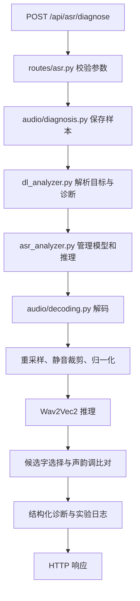
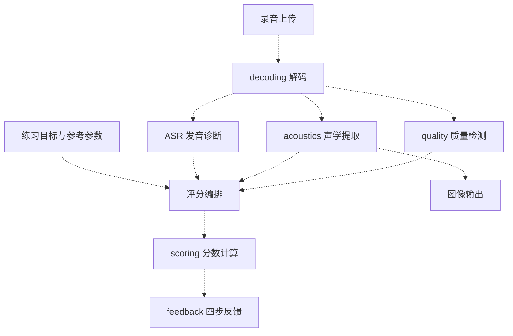

# 音频模块架构

## 当前模块

```text
backend/
├── main.py                 FastAPI 应用，挂载路由
├── routes/
│   ├── asr.py              模型管理、诊断、关卡查询
│   └── audio.py            quality / features / score 占位接口
├── audio/
│   ├── decoding.py         文件解码与转码
│   ├── diagnosis.py        上传诊断流程与实验记录
│   ├── quality.py          录音质量检测
│   ├── acoustics.py        pYIN / LPC / MFCC 声学提取
│   ├── scoring.py          声调、流利度与综合评分公式
│   ├── feedback.py         四步反馈与可靠性判定
│   └── models.py           声学特征、评分输入及输出
├── asr_analyzer.py          Wav2Vec2 模型管理与推理
├── dl_analyzer.py           声韵调诊断
├── pinyin_utils.py          拼音工具
└── levels.py                诊断目标配置
```

解码与质量检测都有实际实现。声学模块也已有 pYIN、LPC 和 MFCC 实现。
Praat、图像输出、音频 ID 存储及新的评分编排尚未实现。

## 已连通的诊断流程



状态、加载、诊断三个接口使用同一个模型管理实例。诊断接口沿用已有诊断规则，
上传样本和 JSONL 实验记录继续保存在 `experiments/`。

## 音频接口状态

| 接口 | 当前状态 |
| --- | --- |
| `POST /api/audio/quality` | 占位，HTTP 501 |
| `POST /api/audio/features` | 占位，HTTP 501 |
| `POST /api/audio/score` | 占位，HTTP 501 |
| `POST /api/audio/analyze` | 已删除，HTTP 404 |

占位接口没有请求体契约，也没有业务调用。前端仍引用已删除的 analyze 接口，
录音结果页需要在新接口实现后重新接入。

## 后续接线位置

下面的虚线表示待实现的编排，并非当前运行链路。



评分函数接收 `AcousticFeatures`、`ScoringEvidence`、`ScoringReference` 和流利度分数。
参考参数由调用方显式提供。ASR 候选概率到评分证据的映射、目标音解析、CMS 检测开关、
失败状态和四步反馈汇总集中在后续评分编排中实现。

本次保留了质量阈值、pYIN/LPC 计算、ASR 预处理和诊断规则、声调/流利度/综合分公式、
四步反馈规则。删除了重复的模型加载与文本音素对比、静态检测白名单、默认参考表和独立 ASR 应用。
声学数据结构中的 `voiced_flag` 拼写已经统一。

## 验证

在仓库根目录执行：

```bash
python -m pytest backend/tests/test_audio_structure.py -q
python backend/test_cms_workflow.py
python backend/eval_scorer.py
```

结构测试使用临时数据库和替代模型对象，覆盖路由、诊断接线与实验记录。
解码测试实际读取 WAV 并经 FFmpeg 处理 WebM，声学测试读取仓库样本。
模型权重的真实推理需要在具备模型和对应运行依赖的环境单独验证。
