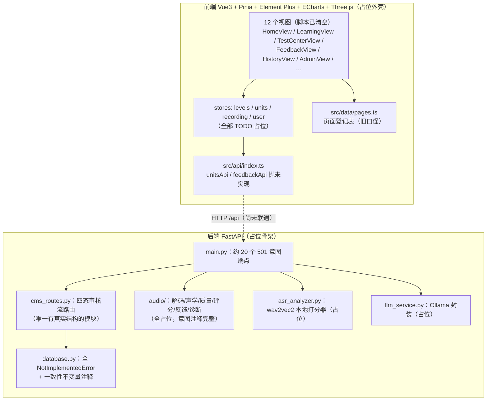

# 01 · 现状盘点与差距分析

> 实读范围：`backend/` 全部 Python 文件、`src/` 关键文件（api / router / stores / data / views / composables / utils）、`docs/srs/` 全部 9 个文件、git 工作区状态。

## 1. 代码库当前形态：双侧占位骨架

仓库正处于一次「清场式重构」的中途：**后端所有业务函数为 `NotImplementedError` / 501 占位，前端所有视图脚本清空、只留 UI 外壳**，但两侧都保留了详细的意图注释。git 工作区有 65 个文件删除（TTS 样例音频、评估脚手架 `eval_scorer.py`、冻结关卡表 `levels.py`、旧文档等）尚未提交，`docs/srs/` 为未跟踪新文件。

值得**保留**的资产（重构中不要丢弃）：

| 资产 | 位置 | 价值 |
| ---- | ---- | ---- |
| 一致性不变量注释 | `backend/database.py` 模块头 | 进度只由记录派生、列表不带 BLOB、时间戳口径统一——这三条与 SRS 完全一致，应作为硬约束继承 |
| 音频管线设计意图 | `backend/audio/*.py` 各模块头 | 幅度口径全链路统一、静音判定全项目只允许一种定义、禁止 NaN 进 JSON——都是踩过坑的结论 |
| 声调曲线处理意图与已知缺陷 | `src/utils/toneCurve.ts` | 「先平滑再归一化」「调域不应取自本次录音」的教训直接对应 FR-1006 |
| 页面状态组件 | `src/components/PageState.vue` + `usePageCopy` | 四态（加载/空/错误/未开放）+ 文案位模式，正好是 SRS 07 章「页面状态」要求的落地形态 |
| 路由失败显性化 | `src/router/index.ts` `onError` | 弱网/断服时「点了没反应」的防御，保留 |
| CMS 审计日志意图 | `cms_routes.py` + `database.get_audit_logs` | 对应 NFR-19，保留并扩展到同意/删除/检测提交 |

## 2. SRS ↔ 代码差距清单

按影响排序。差距编号 G-01 起，供路线图引用。

### G-01 评分主链路方向偏差（最高优先）

- **SRS**：D-06、FR-1205、07 章外部接口——1.0 评分调用**外部普通话评分服务（科大讯飞语音评测接口）**，使用其声韵/调型维度分数与**音节粒度检错信息**生成现象与四步反馈；结果对象稳定包含「质量、分数、现象、四步、可靠性、版本号」。
- **代码**：`asr_analyzer.py`（wav2vec2 CTC 候选打分）+ `audio/scoring.py`（声调曲线/流利度公式）构成**自研本地评分栈**；`ScoreResult` 的字段（accuracy/fluency/pronunciation/tone_combined）是旧口径，与 FR-1010 分类型口径（声韵分/调型分/总分 + 现象 + 可靠性）不匹配。
- **结论**：本地栈与 SRS 并不冲突，但**角色错位**——它应退到两个位置：① 曲线/声学特征与录音质量的工具层；② 2.0 的「专属纠音模型对比」（FR-1605）。1.0 的分数与检错必须来自外部服务，否则 FR-1003（同规则可重复）、FR-1004（音节粒度现象）都要自己重新证明。详见目标架构 §4。

### G-02 CMS 状态机与 SRS 附录 C 不一致

- **代码**（`database.py` `UNIT_STATUS_TRANSITIONS`）：四态 `draft → pending_review → published/rejected`，下架 `published → draft`。
- **SRS** 附录 C：三态 `草稿 → 已发布 → 已下架`，且「已下架 → 已发布」可直接再发布（须重新满足 FR-1203 前置）；**检测开关是独立状态机**（关闭 ⇄ 开放，开放须已发布 + FR-1204）；1.0 单一管理员（D-09），不存在审核角色。
- **连带缺失**：发布前置条件校验（FR-1203：结论/听辨/练习/示范/授权齐全）、开放检测前置校验（FR-1204：朗读文本一致、质量两维接通、允许指标在服务能力内、四步模板齐全、易混关有「仅供参考」）、L30 依赖规则（必测场景：L30 待 L01 与 L09 均已发布后再发布）。

### G-03 前端页面登记表是旧版需求口径

- `src/data/pages.ts` 的 P01–P10 编号与 SRS 4.1 冲突：代码 P05=检测中心、P08=关卡页；SRS **P05=关卡页（/learn）、P08=检测中心（/test）**。
- **缺 P11 账号页**（注册/登录/同意管理/删除入口，FR-106）；无任何账号体系代码（`user.ts` 为 `default_user` 占位）。
- 残留**儿童/家长口径**（childNav、D-15「孩子导航不含发音库」）来自旧版 SRS；现行 SRS 面向大众学习者（D-01/D-02），文案与导航需按 SRS 重写（四个主按钮文案 FR-202、边界句 07 章）。
- 视图冗余：`PronunciationView`、`ComparisonView`、`ProgressView`、`ProgressManagement` 未在路由注册（旧页面遗留）；`HomeView` 模板仍引用已删除的 `unitsStore.coreUnits`；`LearningView` 保留「历史单元」旁路（`UnitLearningPanel` legacy 路径）。

### G-04 账号、同意与数据控制缺失

- **SRS**：FR-101～107（访客可学可录、同意后保存、撤回/删除）、D-08、NFR-15/17/18（服务端逐请求校验登录/同意/发布/检测开关）。
- **代码**：无鉴权（CMS 操作人以 `X-Operator` 头冒充，`cms_routes.py` 自述「第 7 周替换」）；同意仅存 `localStorage`（`useArchiveConsent.ts`），服务端不感知；录音无保留期/归属控制。
- 这是**服务端硬约束**（NFR-15：客户端隐藏入口仅为体验处理），必须在架构里作为独立服务落位，不能继续留在前端。

### G-05 质量两维闸门只有一维

- **SRS**：FR-1301/FR-1001——评分前完成两维检查：① 录音质量（音量/噪声/截幅/时长，信号维）；② **是否按要求朗读**（对照朗读文本检出漏读/增读/回读/替换/乱读，文本维）。任一维不合格即停，只给重录指引。
- **代码**：`audio/quality.py` 只有信号维五项；文本维需要 ASR/对齐能力，恰好可由外部评分服务的检错信息或本地 wav2vec2 承担。**「乱读」判定（评分不可作参考）目前两边都没有设计**。

### G-06 版本与可追溯不完整

- **SRS**：FR-1208（结论可追溯到规则版本+内容版本）、FR-1408（版本历史与回退）、FR-1602（2.0 话术追溯到检测结果版本）、NFR-19（提交检测/发布/下架/检测开关/同意/撤回/删除全部留审计并能还原前后状态）。
- **代码**：仅 CMS 操作日志意图（`get_audit_logs`）；无 `content_version`/`rule_version` 字段设计，无版本快照表；学习记录函数签名中无版本参数。

### G-07 曲线与音域换算的归属未定

- **SRS**：FR-1005/FR-1006——曲线对比前按**本人音域**换算到统一标度；首次用本关自然朗读标定，之后随**档案历史滚动更新**。
- **代码**：归一化实现在前端 `toneCurve.ts`（已删算法留意图），且自己注明缺陷「调域不应取自本次录音」。档案历史在后端 → **换算必须收敛到后端**，前端只渲染最终 T 值序列。两处实现会漂移（正是关卡表双源漂移的重演）。

### G-08 内容真源与种子数据

- 已定且正确：内容走 CMS 单源，代码零内置目录（前后端冻结表均已删）。
- 但 **P04 原理仍是前端硬编码**（`src/data/principles.ts`），与 NFR-12 冲突；30 关内容与示范媒体（原 TTS 样例已删）需要 CMS 录入 + 种子导入方案；FR-1207 媒体授权记录尚无模型。（2026-10-15 修订：P07 已退役，`proMaterials.ts` 直接删除，资料元数据并入 P04 文章 references 与关卡专业折叠；P04 升级为博客式子站，内容迁 CMS content 表，走 `GET /api/content/{key}`。）

### G-09 学习进度的口径

- 不变量已定（进度只由记录派生）✔。但 SRS 的进度来源不止录音：听辨对错（FR-606）计入完成度参考。当前设计只有录音学习记录一种来源，需补「学习事件」。（2026-10-15 修订，D-13：小测移出 1.0，1.0 进度来源 = 听辨 + 练习事件 + 录音。）

### G-10 可测试性

- `eval_scorer.py`、`eval_samples.json`、样例音频已删，仓库当前**没有任何可运行测试**。KPI-2（分数可解释可重复）与「同一合格录音重复提交结果一致」的必测场景，没有回归护栏就无法守护。`dl_analyzer.py` 注释里的「实验日志 JSONL 标定」思路应恢复为离线标定工具。

## 3. 一句话诊断

骨架的**意图注释质量很高**（等于一份隐式设计稿），但它是围绕「本地自研评分 + 四态审核 CMS + 旧版儿童口径页面」写的；SRS 定的是「外部评分服务 + 三态单管理员治理 + 大众口径 P01–P06、P08–P11（P07 已退役）」。**重构的主线不是恢复，而是换靶**：把这套骨架按 SRS 重新瞄准，再往里填实现。
