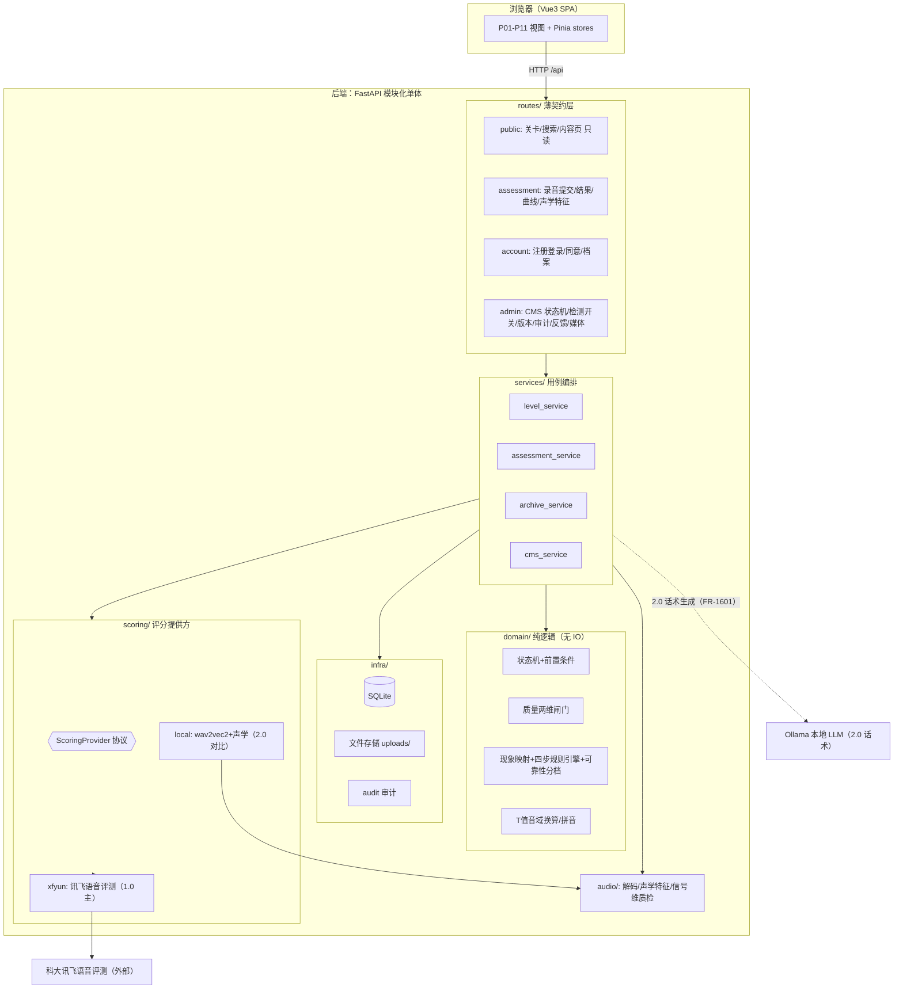
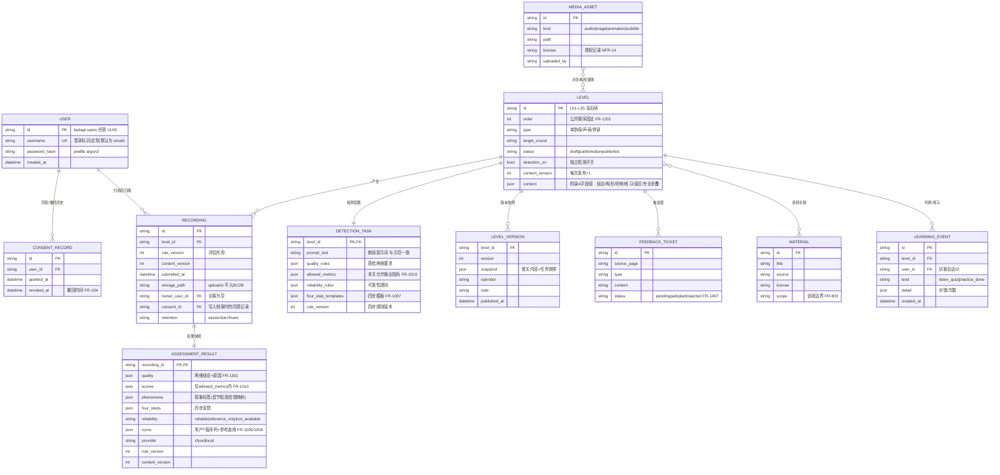
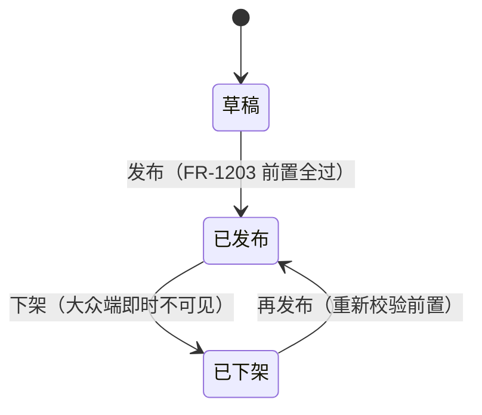
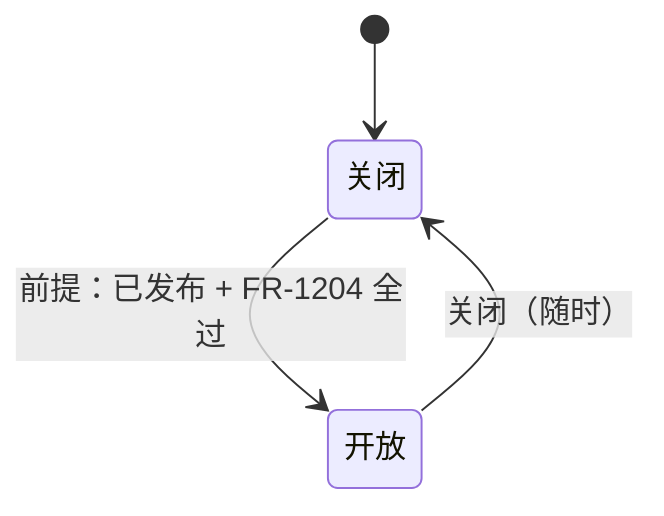
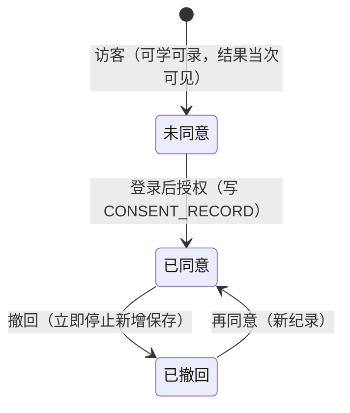
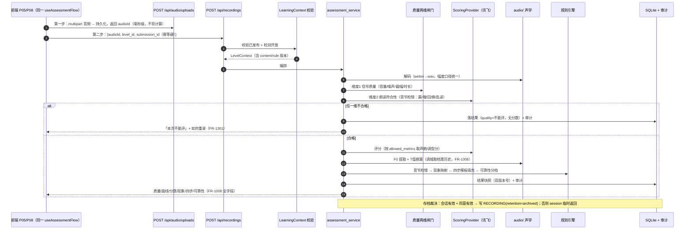
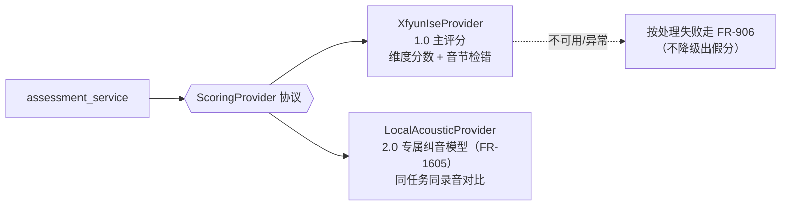
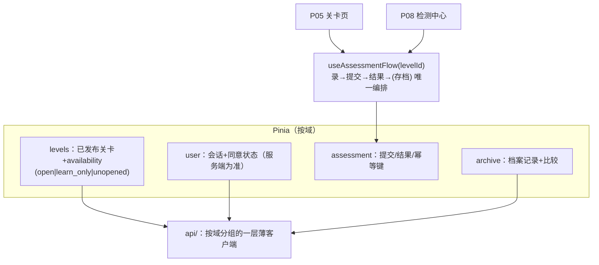

# 02 · 目标架构

> 覆盖 SRS：3.1 学习上下文、3.3 核心对象、附录 C 状态机、FR-901～1010（检测）、FR-101～107（账号）、FR-1201～1408（治理）、NFR-01～19。
> 原则：**小团队、三学期迭代、单一交付物**——一切设计服务于「1.0 冻结可验收、2.0/3.0 可在同一结构上加功能」（D-11/D-12）。

## 1. 总体形态：模块化单体 + 单 SPA

不做微服务、不做消息队列、不做独立模型服务。理由：30 关规模、SQLite 足够、团队为学生团队、NFR-03（≤30 秒出结果）同步调用即可满足。**唯一对外部世界的强依赖是评分服务，用 Provider 协议隔离它**（这是 2.0 换/加模型的全部弹性所需）。



分层规则（用 import 约束，可加 lint 守护）：

- `routes` 只做参数校验与响应组装，不含业务分支；
- `services` 编排事务与外部调用，**所有「SRS 业务规则」的判定都在 `domain`**（可单测、无 IO）;
- `domain` 不 import infra/scoring，评分输入输出走 `scoring/provider.py` 里的纯数据模型；
- 前后端契约唯一登记处：后端 OpenAPI（自动）↔ 前端 `src/types/index.ts`（手抄一次，CI 对不上即失败）。

### LearningContext：每请求重校验（SRS 3.1 / NFR-18）

从搜索、地图、首页、消息任何入口进入学习或检测，服务端都要重新校验「关卡已发布 +（检测入口）检测开关开放」。落为一个 FastAPI 依赖（`deps.py`），所有关卡相关路由统一注入，避免每个端点手写：

```python
async def learning_context(level_id: str, need_detection: bool = False) -> LevelContext:
    """响应码语义（统一 200+code，决策图 #3）：LEVEL_NOT_PUBLISHED=未发布不可见；
    DETECTION_OFF=已发布未开放检测，只学不测（FR-609）。"""
```

## 2. 领域模型（ER）

SRS 3.3 核心对象 → 表。**学习进度不建表**（由学习事件+录音记录派生，继承 database.py 不变量）；录音文件存文件系统，库里只存元数据与路径（旧实现存 BLOB，列表接口曾因此需要专门防泄漏）。



要点：

- `LEVEL.content` 用 JSON 存附录 A 字段组（30 关共用一套结构、管理员单人人肉录入），**不为每个字段组建表**——结构演进靠 JSON + Pydantic 校验，版本快照天然整关一份。
- `ASSESSMENT_RESULT` 同时落 `rule_version` 与 `content_version`，且**质量不合格时 scores/phenomena 为空**（FR-1301：不填分数与检测现象）——这是 KPI-2「可解释可重复」和 FR-1208「可追溯」的落点。
- 访客录音 `owner_user_id` 为空、`retention=session`，用 TTL/会话结束清理，永不进档案查询（NFR-09）。

## 3. 状态机（对齐 SRS 附录 C）

### 3.1 关卡发布状态（替换现有四态）



发布前置（FR-1203）作为 `domain/level_state.py` 的纯函数逐条校验：身份/结论/听辨/3–5 步练习完整、示范可播、授权齐全、误区与专业折叠已写。另加一条**关卡依赖规则**：L30 发布须 L01 与 L09 均已发布（必测场景）。1.0 单一管理员（D-09），直接砍掉 `pending_review/rejected` 两态与对应路由；若 2.0 需要多人治理再加回，状态机集中在 domain 一处，改动是局部的。

### 3.2 检测开关（独立状态机）



FR-1204 校验项：朗读文本与示范一致、质量两维已接通、允许指标 ⊆ 评分服务稳定返回维度（超出者降「暂不评价」）、四步模板齐全、易混关具备「仅供参考」档、关卡内入口与 P08 口径一致。**易混关清单**（FR-403 的 n/l、b/p、d/t、g/k、j/q、z/zh、c/ch、s/sh、f/h、u/ü）作为配置表，供地图并排入口与可靠性降档共用一源。

### 3.3 同意状态（账号域）



已保存条目在撤回后仍可见、可删（FR-104）。**存档裁决只在服务端**：`assessment_service` 在写库前查会话 + 当前有效同意记录，前端 `useArchiveConsent` 降级为纯 UI 提示（NFR-15）。

## 4. 检测流水线（系统的心脏）

一次提交的完整时序（对应 FR-901～1010、NFR-03、NFR-10）：



设计决定：

1. **同步处理**（30 秒超时上限 + 前端进度态）即可满足 NFR-03；`assessment_service` 的接口按「提交→结果对象」设计，将来要异步只需在上包一层 job，不改动内部。不做提前优化。
2. **幂等**（NFR-10）：前端生成 `submission_id` 随第二步 JSON 提交，服务端唯一约束去重，重复提交返回同一结果（重放以 submission_id 为准，忽略 audioId 差异）。
3. **两维闸门的维度 2 复用评分服务返回**：讯飞的音节粒度检错本身就是「漏读/增读/替换」的判定来源，先于分数消费它即可；「乱读」（大量不相关音节）用检错比例阈值判定，阈值进 `DETECTION_TASK.quality_rules`，可按关标定。信号维（维度 1）用现有 `audio/quality.py` 意图实现。
4. **曲线换算归后端**：T 值归一化、调域估计（**指定文本显式标定** + 档案滚动更新，标定走独立端点 `POST /api/pitch-calibration`，见决策图 #7）在 `domain/tone.py` 单实现；前端收到的是可直接渲染的 `{times, user_t[], ref_t[]}`（null 断线交给图表）。`src/utils/toneCurve.ts` 只保留给「录音实时波形」这类纯前端可视化。**前端展示的 F0 曲线、共振峰（F1/F2）等声学信息一律出自后端**：音频先经 `POST /api/audio/uploads` 持久化拿 `audioId`，特征（F0 / 共振峰数值 / 共振峰图片）按 `audioId` 分端点读取（首取计算+缓存，见决策图 #11/#13）；前端不做声学计算，只渲染。
5. **P05 关卡内录音与 P08 检测中心走同一后端端点、同一前端编排**（FR-907 多入口口径一致）：前端收敛为一个 `useAssessmentFlow(levelId)` composable，两个页面只是壳。

## 5. ScoringProvider：唯一的抽象点



协议（纯数据进出，无 HTTP 细节泄漏）：

```python
class ScoringProvider(Protocol):
    def evaluate(self, audio: DecodedAudio, task: DetectionTask) -> ProviderResult: ...
    def stable_metrics(self) -> set[MetricKind]: ...  # FR-1204: allowed_metrics ⊆ 此集合

@dataclass
class ProviderResult:
    syllable_errors: list[SyllableError]   # 音节粒度检错（FR-1004 现象之源）
    metric_scores: dict[MetricKind, float]  # 仅该关 allowed_metrics
    raw: dict                               # 原始返回，供实验日志与 2.0 对比
```

- **现有 wav2vec2/parselmouth 栈整体平移进 `scoring/local/` 与 `audio/`**，不是删除：1.0 里它承担信号维质检、声学曲线与前端可视化特征（F0/共振峰，经公开端点供给）；2.0 里实现 `LocalAcousticProvider` 做同录音对比（FR-1605 要求至少覆盖 L30 + 一类易混声母关）。
- **失败语义**：外部服务不可用 = 处理失败（FR-906，说明环节与下一步），**绝不静默换本地模型出分**——那是「假分」，与 FR-1003 可重复性冲突。
- 2.0 大模型话术（FR-1601）在 Provider 之外另走 `infra/llm.py`：只改写四步文案、管理员确认位入库、可追溯到检测结果版本（FR-1602），不碰分数与现象标签。

## 6. 前端目标结构

### 6.1 页面登记表：按 SRS 4.1 重建（G-03；2026-10-15 修订：P07 退役，1.0 共 10 页，编号空缺不复用，新增自 P12 起）

| 编号 | 页面 | 路由（沿用现有 path） | 备注 |
| ---- | ---- | ---- | ---- |
| P01 | 首页 | `/` | 四主按钮文案 FR-202、搜索提示 FR-203、站点说明 FR-206 |
| P02 | 搜索 | `/search` | 结果仅已发布（FR-303）、无结果相近关 + 希望增加（FR-304） |
| P03 | 发音地图 | `/map` | 三层闯关 + 易混并排（FR-401/403），复用 `LevelRoadmap` |
| P04 | 原理子站 | `/principles`、`/principles/:slug` | 博客式子站（文章目录 + 文章页，不枚举具体音）；内容迁 CMS content 表，`GET /api/content/{key}`（G-08），`principles.ts` 退役 |
| P05 | **关卡页** | `/learn/:id`（`/learn` 重定向 `/library`） | 统一结构 FR-601；构形多视图 FR-603；检测开放才有录音入口 FR-609 |
| P06 | 发音库 | `/library` | 已发布目录 FR-701；目录与比较工具页，不承载进度（与 P03 职责切清） |
| P08 | **检测中心** | `/test` | 任务列表仅可测关 FR-901 |
| P09 | 结果 | `/result/:id` | 全字段 + 边界句 FR-1009 |
| P10 | 声音档案 | `/archive` | 两次比较 FR-1103、删除 FR-104 |
| P11 | **账号（新增）** | `/account` | 注册/登录/退出/同意状态/撤回/删除 FR-106 |

配套动作：删除未路由的 4 个旧视图与 `UnitLearningPanel` 的 legacy 单元旁路；`childNav/childTitle/家长入口` 全部移除，文案位（六槽）保留但按大众口径重写；`HomeView` 模板中已失效的 `unitsStore.coreUnits` 引用一并清理；前端 `AdminView` 与 `/admin` 路由退役（管理界面 = starlette-admin 挂 `/admin`，ADR-13）；`ProfessionalMaterials.vue` 随 P07 删除；`FeedbackView` 更名结果页并迁 `/result/:id`。

### 6.2 数据与编排



- `levels.availability` 三值直接对应 FR-609/D-05：`unopened`（未发布，不渲染）、`learn_only`（只学不测）、`open`（完整闭环）——沿用现有 `LevelAvailability` 类型定义。
- 页面四态继续走 `PageState + usePageCopy`（资产，保留），文案位补齐「未开放/质量不合格/提交中」等 SRS 07 章状态。
- `recording` store 保留「全项目唯一 MediaRecorder 封装」意图，objectURL 生命周期管理照旧。

## 7. 关键技术决策（ADR-lite）

| # | 决策 | 理由 / 放弃的方案 |
| ---- | ---- | ---- |
| ADR-1 | 模块化单体 + SQLite，不做微服务 | 规模与团队现实；微服务只增加部署成本不增加任何 SRS 能力 |
| ADR-2 | 1.0 评分主链路走讯飞，本地 DL 栈定位为质检/曲线工具与 2.0 对比模型 | FR-1205/D-06 的硬要求；自研栈无法自证 FR-1003 可重复与 FR-1004 音节检错 |
| ADR-3 | CMS 状态机对齐 SRS 三态 + 独立检测开关，删除审核两态 | D-09 单管理员；审核流是旧多人治理残留；domain 集中实现使将来加回成本可控 |
| ADR-4 | 内容单一真源 = CMS（SQLite JSON 字段组），代码零内置目录；P04 原理子站内容入 CMS content 表（`GET /api/content/{key}`）；P07 已退役，资料并入 P04 文章 references 与关卡专业折叠 | NFR-12；已删除的冻结表教训（双源漂移）不重演 |
| ADR-5 | 账号 = fastapi-users（CookieTransport + DatabaseStrategy，username 登录定制）+ 匿名 sid Cookie；登录时消费 sid 认领访客数据；同意是服务端记录，存档裁决只在服务端 | FR-101～108、NFR-15；/api/auth/* 挂载路由豁免统一 envelope（决策图 #8）；localStorage 同意仅作 UI 提示 |
| ADR-6 | 录音文件存文件系统（uploads/），库存元数据 | 列表不携 BLOB 的不变量天然成立；SQLite BLOB 备份与体积代价高 |
| ADR-7 | 结果快照携带双版本号（content_version + rule_version）；CMS 保留整关版本快照可回退 | FR-1208/1408/1602、NFR-19、KPI-2 |
| ADR-8 | T 值音域换算收敛到后端单实现 | FR-1006 调域依赖档案历史；前端实现必然双源漂移 |
| ADR-9 | 检测提交同步处理（≤30s 超时）+ 幂等键 | NFR-03/NFR-10；异步队列是 2.0 有真实需求再加的壳 |
| ADR-10 | 前端页面登记表按 SRS 4.1 重建；2026-10-15 修订：P07 退役，1.0 = P01–P06、P08–P11；P05 只留 `/learn/:id`，P09 定名 `/result/:id`，其余 path 不变 | 页号是验收语言（V1-AC 引用 P09 等）；path 稳定则深链不碎 |
| ADR-11 | 进度 = 学习事件 + 录音记录的派生视图，无覆写入口 | 继承 database.py 不变量；补 FR-606 的听辨来源（小测推迟 2.0，D-13） |
| ADR-12 | 每阶段以「可运行纵切 + 契约测试」收口；离线标定工具恢复为 scripts/ | 仓库当前零测试；KPI-2 与必测场景需要回归护栏 |
| ADR-13 | 开源包同进程整合：fastapi-users 挂 /api/auth/*（envelope 豁免，原生语义），管理界面（starlette-admin 优先）挂 /admin 且自带单管理员登录；数据库维持 SQLite（SQLAlchemy 接入层，换 Postgres = 一行 URL） | 决策图 #8/#9/#10（2026-10-15）；CMS 治理动作走管理界面自定义动作调 domain，cms_routes 的 /api/admin/units/* REST 退役 |
