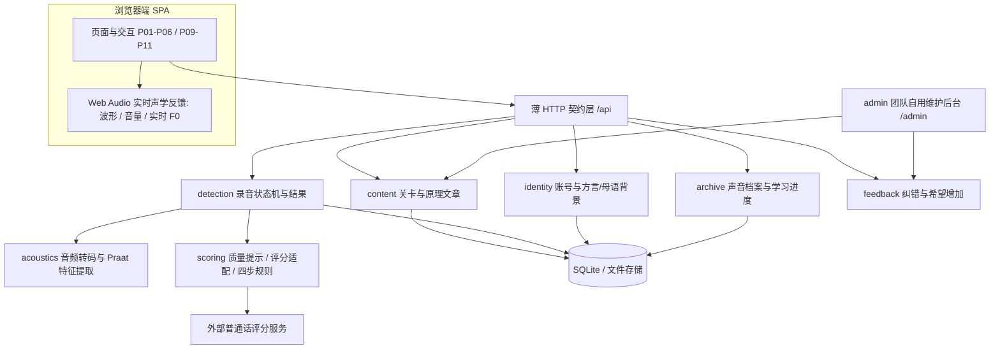
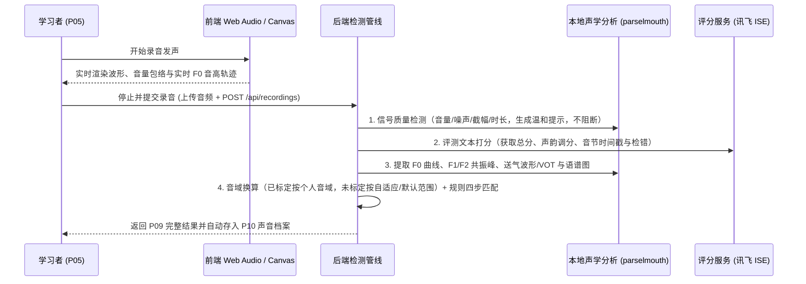

# 02 · 目标架构

> 范围：SRS 全部 1.0 需求及 2.0/3.0 扩展边界。业务需求以 [SRS](../srs/README.md) 为准，API 契约见 [后端决策图](../decision-map-backend.md)，前后端实施细节见 [03-后端架构与实施方案](03-后端架构与实施方案.md) 与 [04-前端架构与实施方案](04-前端架构与实施方案.md)。

## 1. 部署形态与模块边界

采用 **FastAPI 同进程模块化单体 + Vue 3 SPA**；SQLite 保存结构化数据，本地文件系统保存音频与媒体资源。认证采用轻量级服务端会话（用户名/密码 + HttpOnly Cookie），后台采用同进程轻量管理面板（`starlette-admin` / `sqladmin`）供团队内部维护内容。1.0 外部语音评分为唯一必需外部服务，不引入微服务或独立消息队列。

各模块管理自身数据与用例接口：`api` 层负责请求校验与统一响应封装，用例层编排业务逻辑与数据库事务，领域层处理纯规则（进度派生、四步反馈匹配、音域换算）。

## 2. 核心逻辑数据模型

| 对象 | 数据与职责 |
| ---- | ---- |
| `Level` | 关卡 ID（L01–L30）、顺序、层级（单韵母/声母/拼读）、目标音、代表汉字、是否开放、构形配置（内容媒体、2D 声道剖面关键帧 `sagittal.keyframes[]`、3D 模型引用）、示范媒体、听辨题 `quiz[]`、分步练习 `practice[]`、误区、声学说明、检测配置与参考曲线 |
| `Article` / `Category` | 原理文章 `slug`、标题、分类（气/声/口型）、Markdown 正文、示范音频、短练习、参考资料与关联关卡 |
| `MediaAsset` | 媒体文件元数据（音频、图片、动图、视频、3D 模型）与本地存储路径 |
| `User` / `Session` | 账号 ID、用户名、密码哈希、**方言区/母语背景（`dialectBackground`，可选）**、创建时间及服务端登录会话 |
| `PitchCalibration` | 用户个人音高音域（F0 范围）与元音空间（F1/F2 基线），支持跳过标定直接检测；已完成标定时可结合历史合格录音动态更新 |
| `Audio` | 上传音频 `audioId`、所属用户、用途（`recording` / `calibration`）、PCM 哈希、时长、文件路径及提取的声学特征缓存（F0、共振峰、波形/语谱图） |
| `Recording` / `AssessmentResult` | `recordingId`、`audioId`、`userId`、`levelId`、`submissionId`、处理状态（`processing` / `completed` / `failed`）与阶段 `stage`；结果包含环境质量提示 `quality`、评分 `score`、可观察现象 `phenomena[]`、四步反馈 `fourSteps[]`、基频对比曲线 `curve`、元音空间共振峰 `formants` |
| `LearningEvent` | 用户听辨作答（`listen_quiz`）与练习步骤完成（`practice_done`）记录，用于按 D-24 规则派生关卡完成度与下一关 `nextLevelId` |
| `Feedback` / `Wish` | 用户提交的纠错反馈与「希望增加」记录及后台处理状态 |

## 3. 检测与声学分析闭环

- **前后端声学分工**：
  - **前端实时反馈（发声中）**：利用浏览器 `AudioContext` 在本地内存中实时计算并绘制动态波形、音量（RMS）和实时音高（F0）曲线，满足发声过程中的零延迟视觉监控（FR-907）。
  - **后端精细分析（提交后）**：后端统一将音频转码为 16kHz 单声道 PCM，结合外部评分服务的音节边界时间戳与本地 `parselmouth`（Praat）算法，精确提取音节分段的 F0 曲线、元音段 F1/F2 共振峰、辅音送气段波形（VOT）及宽带/窄带语谱图，保证跨设备结果一致且可重复（FR-1003、FR-1005）。
- **短同步 + 202 回落**：提交后在同步窗口（约 8 秒）内完成则直接返回 `200`；超出窗口返回 `202 PROCESSING`，前端展示当前阶段并轮询，30 秒未完成判超时失败并支持同 `submissionId` 重试（D-19）。

## 4. 架构决策（ADR）

| 编号 | 决策 | 依据与说明 |
| ---- | ---- | ---- |
| ADR-1 | 同进程模块化单体 + SQLite + 本地文件存储 | 契合团队规模与单交付物部署，省去分布式队列与多服务运维成本 |
| ADR-2 | 登录即用 + 个人资料含方言/母语背景 | 简化账号流程（D-08），方言/母语背景支撑针对性教学提示、2.0 大模型话术与实验分组统计 |
| ADR-3 | 实时 Web Audio + 事后 Praat 双层可视化 | 兼顾发声时的零延迟生物反馈（FR-907）与提交后的高精度声学对比（FR-1005） |
| ADR-4 | 音域标定可跳过、录音质量仅提示不拦截 | 降低首次使用门槛（D-20），避免因麦克风环境差异阻断学习闭环（FR-1001、FR-1301） |
| ADR-5 | 轻量后台直接维护内容 | 团队自用后台（D-09）直接增删改查关卡、文章与媒体，保存即生效 |
| ADR-6 | 2D 声道剖面关键帧参数化 | 按发音器官位置关键帧（`sagittal.keyframes[]`）驱动前端插值绘制，统一支持静态口型与动态发音过程（FR-603） |
| ADR-7 | OpenAPI 契约驱动前后端类型同步 | 后端 `schemas.py` 导出 OpenAPI，前端自动生成 TS 类型并支持 `api:check` 漂移检查 |
