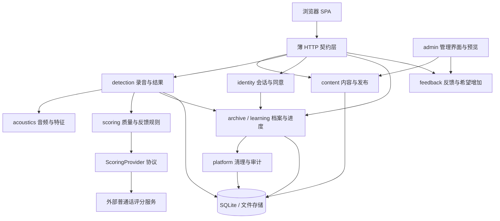
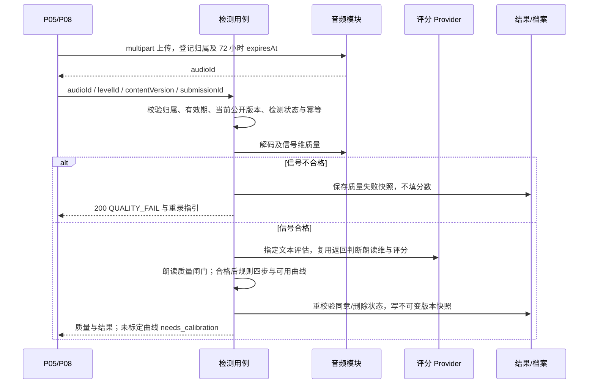

# 02 · 目标架构

> 范围：SRS 全部 1.0 需求及 2.0/3.0 扩展边界。本文是目标规划，未检查或断言代码已实现。业务以 docs/srs/ 为准，完整 API 以 [后端决策图](../decision-map-backend.md) 为准。

## 1. 部署形态与模块边界

FastAPI 同进程模块化单体 + Vue SPA；SQLite 保存结构化数据/版本，文件系统保存音频与媒体。fastapi-users 作为认证基础库同进程接入，管理界面优先 starlette-admin（sqladmin 备选），通过认证扩展配置单管理员。1.0 外部评分为唯一必需业务外部服务；2.0 的本地模型和大模型话术按真实需求接入，不提前引入微服务、消息队列。

模块拥有自己的数据与用例接口；routes 处理 HTTP 校验/响应，用例编排权限、事务与 IO，纯领域规则处理状态机、质量和反馈判定。跨模块通过用例接口协作，管理员不直接修改已发布版本或私人录音。platform 横切承担 requestId、权限、CSRF、限流、审计和可靠清理。

## 2. 逻辑数据模型

以下为业务模型及持久化边界，不限定具体表名/列实现。

| 对象 | 数据与约束 |
| ---- | ---- |
| Level / Article 身份 | 稳定 id/slug、发布状态、当前公开版本指针；关卡预先公开的身份字段可作地图骨架 |
| LevelDraft / ArticleDraft | 可编辑内容、草稿修订号；检测任务/规则属于关卡草稿；与公开版本分离 |
| LevelVersion / ArticleVersion | 不可变快照、版本、发布人/时间/原因；关卡快照含任务、规则、示范、授权引用；回退创建新发布记录 |
| Category / Media | 分类及文章公开分类快照、媒体用途/归属/授权/发布引用；私有授权材料不公开 |
| Audio | audioId、所有者 sid/账号、用途、内容哈希、格式、时长、文件引用、首次上传时间、expiresAt、删除状态 |
| Recording | recordingId、audioId、所属关卡公开版本、ruleVersion、提交时间、submissionId、处理状态、归属、session/archived、consentId、有效期 |
| AssessmentResult | 质量两维、分数、现象、四步、曲线及缺失状态、Provider/模型版本、音域与算法快照、内容/规则版本；质量不合格不填分数/现象 |
| User / Session | 用户名、认证凭据、认证会话；独立匿名 sid，登录绑定/退出轮换；注销失效全部会话 |
| ConsentDecision | 只追加 granted/rejected/revoked 决定、文案版本、时间、操作引用；当前状态从历史派生（无记录为未处理） |
| PitchCalibration | 同意后个人或临时会话音域、文本版本、来源、有效性与版本；临时标定受 72 小时约束 |
| LearningEvent | 仅登录且同意后新增，eventId 去重、关卡/内容版本、listen_quiz 或 practice_done；进度只读派生，不独立覆写 |
| Feedback / Wish | 情境、文字、处理状态、受控结果/版本引用；删除私人数据时去引用，不复制录音 |
| Feature / Scoring cache | 权限所属、音频内容/版本/算法/音域键、有效期；删除源数据级联清除，不跨账号共享私人缓存 |
| Audit / Deletion record | 操作与状态骨架、requestId、版本、清理状态；撤回/注销后匿名化，不保留私人内容 |

同一用户多次录音可复用音频，但删除须按有效引用判定，禁止物理删除另一个仍有效档案的文件；删除共享缓存引用需同时保证被删 recordingId 不可读取。未引用上传与临时录音均 72 小时，不存在「提交一次就永久转正」。

## 3. 状态与访问

内容三态：草稿 → 已发布 → 已下架；已下架可再次发布，均检查前置条件。已发布内容允许同时存在编辑草稿；重新发布成功原子替换公开版本，失败保留原版本。版本回退不改写历史快照。正常已发布关检测就绪；独立开关仅作应急熔断，故障可见且有审计，冻结时全部已发布关可测。L30 与 L01/L09 的导航关系不是额外发布依赖。

同意状态：未处理 / 已同意 / 已拒绝 / 已撤回；决定只追加。登录只绑定当前 sid 的临时录音；登录且同意有效时自动转存本会话全部未过期、未删除记录，重复操作不重复建档。注册不构成登录，登录不构成同意。退出/切换账号轮换 sid，断开旧账号关系；共用设备同意前须明确转存范围，允许先删除或重置访客会话。

所有录音、audioId 文件/特征/图片/结果读取共享权限：临时数据当前 sid 或绑定账号匹配且未过期；已存档仅本人账号；访客资源一旦绑定账号，sid 单独不再授予访问。不可猜测 ID 仅减少枚举，不替代权限。管理员预览只授权绑定草稿及媒体，不能读私人录音。公开内容每次校验发布引用；地图骨架不带正文/媒体/任务。

## 4. 检测与一致性

同步评分在 30 秒内返回结果或明确失败，上传时长受网络及大小影响，不承诺毫秒级。同步请求期间前端本地显示处理态；发生网络中断或重复提交可按 recordingId 查询。相同所有者+submissionId 同负载重放，不同负载 409，处理中 202 PROCESSING；重放校验当前归属与删除状态，但不重算已有版本结果。首次与重试的 requestId 不同，原业务操作可追溯。

不同 submissionId 提交相同音频，按所有者+音频哈希+内容/规则+Provider/模型版本复用评分结论，确保分数/现象/四步可重复；瞬时 Provider 失败允许重试，不固化为成功缓存。音域/算法版本影响曲线，快照记录当时基准，历史结果不因新标定重算。未标定正常评分，只有曲线 needs_calibration；无有效 F0 为 not_available。F0/共振峰/PNG 按 audioId 首取计算及独立缓存，前端只渲染；公开示范与私人上传的授权不同。

ScoringProvider 隔离服务差异、指标与音节检错；实际服务维度及乱读/漏读规则须逐关验证，禁止需求层预设所有维度都准确可用。Provider 不可用返回处理失败，不静默换本地模型出分。2.0 专属模型对比按 FR-1604，大模型只改写管理员确认的话术（FR-1601/1602），不修改质量、分数、现象。

## 5. 进度与数据生命周期

访客/未同意进度只在前端本地，服务端不收 sid 学习事件；同意后只上传新的事件（eventId 幂等），不自动导入历史本地进度。服务端按版本验证题目与选项，派生正确性，进度由有效学习事件与存档记录计算；推荐只用同意有效数据，访客/未同意回落 L01/第一已发布关。

私有未存档上传、录音/结果、临时标定与缓存从首次上传起最多 72 小时，不续期；已存档保留至用户删除。撤回立即停止保存并拒绝读取被删资源，再删除账号全部临时/长期录音、结果、文件、特征/评分缓存、学习事件/进度和音域；注销同范围且校验密码/失效全部会话。单删/清空档案不等于撤回，独立学习事件保留，基于被删录音推算的音域须重建或失效。

清理在同部署内调度，幂等重试与监控；到期/用户删除立即逻辑失效，最迟 24 小时完成本地硬删。备份默认不含私人音频/特征，启用时默认最长 7 天，恢复前重放删除记录；第三方留存和删除按实际条款核实。删除/撤回与在途评分或转存并发时禁止数据复活；审计仅保留匿名化操作骨架。

## 6. 前端契约与 CMS

大众端为 SRS P01–P06、P08–P11 共 10 页；P04 使用分类/文章列表/文章详情；P03 使用公开地图骨架加本地或授权进度；P01/P06/P08 过滤未发布骨架。搜索使用服务端 /api/search；P05/P08 复用同一录音编排；P09 按 recordingId 恢复，P10 使用 /api/me/recordings 及本人同关 compare。context 对访客开放，不能为初始化页面强制查询受保护的 /me/progress。

后台 /admin 配置单管理员鉴权，草稿编辑、前置检查、对比、发布/下架、应急检测熔断、版本回退、分类迁移、授权媒体、反馈/希望增加、标定文本和审计通过用例完成。后台签发短期（默认 15 分钟）预览令牌，绑定管理员会话、对象和草稿修订，前端真实 /preview 页面读取同结构草稿与受控媒体；修改修订或退出后失效。分类更名与文章归属不得穿透草稿立即公开。

JSON camelCase 与标准 HTTP、envelope/requestId；文件、Range 与缓存原生响应。OpenAPI 自动生成前端 TS；身份/公开状态每请求重校验，限流覆盖上传/评分/特征/标定/反馈/注册/登录，受控并发与 Origin/CSRF 校验保障资源及写操作。

## 7. ADR-lite（当前定案）

| # | 决策 | 依据 |
| ---- | ---- | ---- |
| ADR-1 | 模块化单体、SQLite、单 SPA | 小团队与单交付物；后续数据库迁移需专门评估 |
| ADR-2 | 外部评分 + Provider 隔离；不静默换模型 | D-06、FR-1205、FR-1604 |
| ADR-3 | 三态内容发布 + 仅应急的独立检测熔断 | D-05、FR-1202/1203 |
| ADR-4 | CMS 单一真源，身份/草稿/不可变公开版本分离，文章级发布 | FR-1413、NFR-12 |
| ADR-5 | fastapi-users 认证适配 + sid 绑定；有效同意后自动全部转存 | D-14、FR-102 |
| ADR-6 | 文件系统存音频，库存元数据/权限/引用 | 附录 B、NFR-17 |
| ADR-7 | 结果版本/Provider/音域快照 + 不可变内容历史 | FR-1208、FR-1003 |
| ADR-8 | 后端声学及 T 值，显式标定且未标定不阻塞评分 | FR-1005/1006 |
| ADR-9 | 两步提交，同步检测、负载一致幂等与版本化评分缓存 | NFR-03/10、KPI-2 |
| ADR-10 | 10 个页面、真实管理员草稿预览及媒体权限 | D-03、FR-1412 |
| ADR-11 | 授权账号进度只读派生，未授权仅前端本地且不自动导入 | D-16、FR-606 |
| ADR-12 | 按纵向业务验收与契约验证收口 | SRS 08 V1-AC18–27 |
| ADR-13 | 账号/管理库同进程，管理员认证独立配置 | D-09；不依赖学习账号管理员标志 |
| ADR-14 | 临时数据统一 72 小时，删除本地上限 24 小时 | D-15、NFR-09（24 小时为架构默认） |
| ADR-15 | 撤回/注销删录音、进度、音域，审计匿名骨架 | D-17、FR-104/108 |
| ADR-16 | 标准 HTTP + requestId，媒体原生 Range/缓存 | D-18、NFR-06/19 |

未核实事项只作为实现前验证：认证库兼容版本/用户名适配、管理扩展、Provider 的真实维度与延迟/留存、备份策略。当前规划不把库默认字段、管理登录、SQLite 性能或更换数据库成本当作已验证事实。

本地删除边界：当前设备在撤回/注销时清除相关进度与音域；其他离线设备在下次联网重新校验账号与同意后清除，服务端不能远程立即擦除离线浏览器存储。自动转存不包括未提交检测的孤儿上传；处理中录音完成时重校验同意，质量不合格记录只保留质量结论与重录指引。
