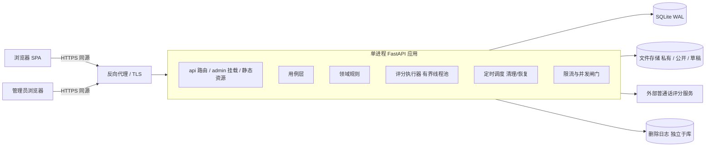

# 03 · 后端架构与实施方案

> 范围：1.0 后端的运行形态、分层与模块安排、关键流程、一致性与安全机制、测试策略和实施计划，并给出 2.0/3.0 演进位。业务以 [SRS](../srs/README.md) 为准，API 契约以 [后端决策图](../decision-map-backend.md) 为准，模块边界与逻辑模型见 [02-目标架构](02-目标架构.md)。本文不含代码实现，也不断言任何依赖已验证。

## 1. 总体形态



| 维度 | 安排 |
| ---- | ---- |
| 进程 | 单进程、单 worker；异步 HTTP 处理 + 有界线程池执行 CPU/外部调用重任务 |
| 同源 | 反向代理把 `/`（SPA 静态）、`/api`、`/admin` 指向同一应用；Cookie 统一 SameSite=Lax、HttpOnly、Secure |
| 存储 | SQLite（WAL、外键开启、busy_timeout）存结构化数据；文件系统分 `private/`（用户音频、标定音频）、`public/`（已发布引用媒体）、`draft/`（草稿媒体、授权材料） |
| 外部 | 1.0 只依赖评分服务；无消息队列、无独立缓存服务 |
| 配置 | 环境变量 + 配置文件：同步窗口、硬截止、执行器大小、队列上限、限流额度、上传上限、Provider 凭据（仅环境变量） |
| 备份 | 每日 SQLite 在线备份，保留 ≤7 天，不含 `private/` 文件；删除日志单独追加保存，恢复备份后先重放删除日志再对外服务 |

**选择单进程的理由**：1.0 是单管理员、学习者规模有限的产品，瓶颈在外部评分时延，不在 CPU。单进程让限流、调度、执行器、搜索索引都可以放在内存里，省掉分布式锁和队列。代价是不能水平扩容，扩容前须把限流与调度迁入 SQLite 或外部存储（记录为已知演进项）。

## 2. 技术选型

| 关注点 | 选型 | 说明 / 待验证 |
| ---- | ---- | ---- |
| Web 框架 | FastAPI + Pydantic v2 | OpenAPI 为契约真源；统一 camelCase 别名 |
| ORM / 迁移 | SQLAlchemy 2 + Alembic | SQLite 方言；迁移脚本随版本提交 |
| 认证 | 自研轻量层：argon2 密码哈希 + 服务端会话表 | 用户名登录、sid 绑定、注销即全会话失效均需定制，自研比改造邮箱优先的认证库更直接 |
| 管理界面 | starlette-admin（sqladmin 备选） | 自定义动作承载发布/下架/回退/熔断等用例；须验证自定义页面与独立认证能力 |
| 音频处理 | ffmpeg 转码为 16 kHz 单声道 16-bit PCM | iOS Safari（mp4/aac）与 Chrome（webm/opus）统一；内容哈希基于规范化 PCM |
| 声学特征 | Praat（parselmouth）提取 F0 与共振峰 | 算法版本号写入缓存键与结果 |
| 拼音 | pypinyin | 搜索时把任意汉字拆为声母/韵母映射到关卡 |
| 评分服务 | 讯飞语音评测（WebSocket） | 须验证：音节时间戳、声韵调维度、乱读/漏读字段、单韵母与声母代表音节的评测形式、p95 时延、数据留存条款 |
| 调度 | 进程内 asyncio 周期任务 | 单进程前提下无需外部调度器 |
| 契约 | openapi-typescript | CI 比对导出的 OpenAPI 与前端生成类型 |

## 3. 分层与代码组织

```
app/
  platform/      requestId、envelope 与错误映射、审计、限流与并发闸门、CSRF/Origin、调度、删除日志、配置
  content/       关卡/文章/分类/媒体/参考发音人；发布用例；公开读模型；搜索索引；预览令牌
  acoustics/     上传、转码、哈希、私有音频读取守卫、F0/共振峰提取与特征缓存
  scoring/       Provider 适配器（协议 + 讯飞实现 + 测试替身）、质量两维、规则引擎、T 值与归一化、评分缓存、标定计算
  detection/     录音状态机、提交用例、执行器调度、结果快照
  identity/      用户、认证会话、sid、同意决定、dataEpoch、注销
  archive/       转存、个人音域、档案查询与比较、会话临时记录、学习事件与进度
  feedback/      反馈、希望增加
  admin/         starlette-admin 视图与自定义动作（只调用各模块用例）
  api/           路由：请求校验、调用用例、响应映射
```

每个模块内部分 `domain`（纯规则：状态机、质量判定、四步匹配、发布前置检查）、`application`（用例：权限、事务、编排）、`infrastructure`（表映射、文件、Provider 客户端）。依赖规则：

- 路由只调用用例，不直接访问表。
- 模块之间只调用对方公开用例或查询接口，不跨模块读写表。
- 跨模块原子操作（转存、撤回、注销、发布）由发起方用例在一个数据库事务内编排；文件删除放在事务提交后，经删除日志保证最终完成。
- admin 与 api 是平级的两个入口，共享同一套用例；admin 不绕过用例写公开版本。

## 4. 数据模型概要

逻辑对象见 02-目标架构第 2 节，这里只列各模块持有的主要表与关键约束。

| 模块 | 主要表 | 关键约束 |
| ---- | ---- | ---- |
| content | level、level_draft、level_version、article、article_draft、article_version、category、media_asset、media_ref、reference_speaker、calibration_text、detection_switch、sagittal_preset | version 行只插入不更新；level_version 冻结构形（含声道剖面关键帧）、听辨题与练习步骤（稳定 questionId/stepId）、检测任务与标准曲线；media_ref 在发布/下架/回退事务中维护，用于判定公开可读；calibration_text 有版本；sagittal_preset 仅供后台录入起步，不参与公开读取 |
| acoustics | audio、feature_cache | audio 记录 owner（sid 或 user）、purpose、pcm_hash、first_uploaded_at、expires_at、deleted_at；feature_cache 键含算法版本，缓存原始 F0、共振峰与共振峰图片，供 `/api/audio/{audioId}/f0`、`/formants`、`/formants.png` 读取，随音频删除级联清除 |
| scoring | score_cache、pitch_range、pitch_range_snapshot | score_cache 键见决策图；pitch_range 每个所有者一条现行记录，snapshot 只插入并记录来源 |
| detection | recording、assessment_result | (owner, submission_id) 唯一；recording 记录 status/stage/attempt/deadline_at/epoch_at_start；result 只插入 |
| identity | user、auth_session、anon_session（sid）、consent_decision、username_tombstone | consent_decision 只插入；user.data_epoch 单调递增；注销后用户名以单向哈希留在 tombstone 中 |
| archive | learning_event | (user_id, event_id) 唯一；记录 kind 与 questionId/stepId、服务端派生的对错；进度按 D-24 只读派生，不存完成标志 |
| feedback | feedback、wish | 私人引用字段可置空；处理状态只允许状态机内转移 |
| platform | audit_log、idempotency（如需）、job_lease | audit 匿名化时只清除可识别字段，保留操作骨架 |

ID 一律使用不可猜测的随机 ID（如 UUIDv7 或 ULID）；关卡保留业务 ID（L01 起）。

## 5. 关键流程

### 5.1 检测提交（短同步 + 超时回落 202）

1. **受理**：校验 sid/会话、限流；校验 audioId 归属、未过期、purpose=recording；校验关卡已发布、检测未熔断、contentVersion 等于当前公开版本（否则 409）；校验存在有效音域（否则 409 CALIBRATION_REQUIRED，不建记录），并记下本次使用的音域快照。
2. **幂等**：按 (owner, submissionId) 查询录音。负载不同返回 409；completed 时重放结果；processing 时返回 202；failed(retryable) 时 attempt+1 重新执行；不存在则插入 processing 记录，记下 deadline_at = 受理时刻 + 30 秒和当前 dataEpoch。
3. **投递**：提交到有界执行器；队列已满返回 503 SERVER_BUSY。
4. **等待**：路由在同步窗口（约 8 秒）内等待任务完成，完成返回 200 {recording, result}，否则返回 202 {recording}（含 stage，Retry-After 2 秒）。recording 带 audioId 供前端回放与读取原始特征。
5. **执行**：signal_check（本地，不合格直接收尾）→ 查评分缓存 → scoring（Provider，不持有数据库事务；单次超时取剩余预算，连接错误且剩余预算足够时自动重试一次）→ 朗读维判定 → 规则引擎四步 → analyzing（F0 按音节分段、T 值换算、单韵母关共振峰归一化）。每个阶段更新 stage（短事务）。
6. **收尾**：在一个短写事务中重校验录音未删除/未过期、所有者 dataEpoch 未变、未超过 deadline；读取此刻同意状态决定 archived 或 session；写结果快照与评分缓存。任一校验失败即丢弃并登记清理。
7. **超时与恢复**：调度器每数秒把超过 deadline 的 processing 记录置为 failed(retryable, TIMEOUT)；进程启动时对遗留的 processing 做同样处理。同键重试由前端在提交页面内发起；后端不为跨页面重试提供额外接口。

### 5.2 标定与音域

1. 前端在检测前强制引导朗读标定文本（覆盖六个单韵母并有音高起伏），上传 purpose=calibration；无有效音域时检测提交被拒绝（5.1 第 1 步）。
2. 同步处理（同样占用执行器与 30 秒上限）：信号质检 → 调用 Provider 获取音节时间戳 → 按音节提取 F0 与元音段 F1/F2 → 稳健百分位得音高音域，六个元音的均值/标准差得元音空间。
3. 失败（无有效 F0、元音缺失）时返回 200 CALIBRATION_FAIL 和重录指引，不写入音域。
4. 成功后按同意状态写入个人音域基线或会话临时音域，生成新的 snapshot；标定音频立即登记删除。
5. **滚动更新**：已同意用户每新增一条存档合格录音，按「最近一次标定基线 + 最近 N 条（默认 20）存档合格录音的 F0 统计」重算个人音域并生成新 snapshot；元音空间只随重新标定更新。
6. **删除重算**：被删录音若在当前音域的来源中，按剩余来源重算；无剩余录音时回到标定基线。已有结果引用的旧 snapshot 只保留数值，不保留来源音频。
7. **标准曲线**：关卡发布时，用参考示范和参考发音人登记的音域计算 T 值曲线并冻结进 level_version；参考发音人的登记方式与用户标定相同，由管理员在后台完成。
8. **有效音域判定**：个人音域存在，或当前会话临时音域未过期，即为有效；撤回、注销后个人音域被删除，会话标定 72 小时到期，均需重新标定后才能提交检测。context.calibration 返回同一判定结果供前端预先引导。

### 5.3 登录、同意与自动转存

- **登录**：已登录则先执行退出（失效会话、轮换 sid）；校验密码；创建认证会话；把当前 sid 绑定到账号，sid 下的临时资源归属改为账号；若同意有效，在同一请求中执行转存。
- **授予同意**：追加 consent_decision（已是 granted 时不追加）；执行转存。
- **转存（单事务）**：选取当前绑定会话内本账号的 session 记录（completed、未过期、未删除）→ 改为 archived 并登记 consentId → 被引用的音域快照转为长期 → 未过期会话标定升级为个人音域（与已有个人音域比较取较新的）→ 写审计 → 返回 transferredCount 与 calibrationUpgraded。
- 处理中的录音不在本次转存内，由 5.1 第 6 步按完成时的同意状态自然归档。
- 失败时整个事务回滚，前端以再次授予同意重试；由于记录状态已是 archived 的不会再选中，重试天然幂等。

### 5.4 删除、撤回与注销

| 操作 | 同步阶段（单事务） | 异步阶段（调度器，≤24 小时） |
| ---- | ---- | ---- |
| 单删录音 | recording、result 置 deleted；若 audio 无其他有效引用则置 deleted；音域重算；反馈去引用；写删除日志与审计 | 删除文件、特征缓存、评分缓存 |
| 清空档案 | 对本人全部 archived 执行单删逻辑；音域回到标定基线 | 同上 |
| 会话重置 | 当前会话全部 session 记录、未引用上传、会话标定置 deleted；访客轮换 sid | 同上 |
| 撤回同意 | 追加 revoked；dataEpoch+1；本人全部录音（含临时）、结果、事件、个人音域置 deleted；反馈去引用；审计匿名化 | 同上，另删标定与派生数据 |
| 注销 | 校验密码；执行撤回范围；用户名写入哈希墓碑；清除可识别字段；全部认证会话失效 | 同上 |

- 被删或过期资源的所有读取路径立即返回 404：读取守卫统一检查 deleted_at 与 expires_at，不依赖物理删除。
- 在途评分因 dataEpoch 或 deleted_at 校验失败而无法写回（见 5.1 第 6 步）。
- 删除日志独立于数据库追加写入，供清理任务重试，也供备份恢复后重放。

### 5.5 内容发布、下架、回退与预览

- **发布**：读取草稿 → 运行前置检查（逐项返回缺失字段；含构形媒体与替代文本、声道剖面至少一帧且取值合法、听辨题与练习步骤 ID 唯一）→ 计算标准曲线 → 插入新 level_version → 更新当前版本指针与状态 → 重建 media_ref → 刷新内存搜索索引与导航 → 审计。任一步失败整体回滚，原公开版本不变。
- **下架**：状态改为已下架 → media_ref 移除该关引用 → 刷新索引 → 列出受影响文章供后台提示。
- **回退**：以上一公开版本内容插入新的 version 记录，再按发布流程执行，不改写历史版本。
- **熔断**：detection_switch 按单关或全局记录开关、原因、操作者；levels 接口的 availability 与提交接口同时读取该开关。
- **预览**：令牌绑定 (admin_session, kind, id, draft_revision, exp)；草稿修订号变化或管理员退出即失效；预览媒体只允许该草稿引用的 media。令牌以 query 传递，后台（含文章 Markdown 预览）只负责签发并打开前端 `/preview/...?token=`，不在后台另做渲染。
- **公开媒体读取**：每次请求检查 media_ref 中是否存在已发布引用，再返回文件或 304，响应头为 `Cache-Control: no-cache` + ETag。

### 5.6 定时任务

| 任务 | 周期 | 内容 |
| ---- | ---- | ---- |
| 处理超时 | 5 秒 | processing 超过 deadline 的置为 failed(retryable) |
| 临时到期 | 5 分钟 | 过期的 session 录音、上传、会话标定置为不可读并登记删除 |
| 物理清理 | 5 分钟 | 按删除日志删除文件与缓存，失败指数退避重试；超过 12 小时未完成即告警 |
| 预览令牌 | 15 分钟 | 清理过期令牌 |
| 自检 | 1 小时 | 报告清理积压、执行器队列、Provider 错误率 |

## 6. 并发与一致性

- **SQLite**：WAL 模式支持并发读；写事务保持短小，任何外部调用（Provider、ffmpeg、特征提取）都不在事务内进行；busy_timeout 吸收短暂写锁竞争。
- **执行器**：线程池大小与队列上限可配置（初始 4 / 32），评分、标定、特征提取共用一个全局并发闸门。
- **写回守卫**：所有异步写回统一校验「资源未删除 + 未过期 + 所有者 dataEpoch 未变」，这是撤回/删除与评分/转存并发时不复活数据的单一机制。
- **幂等**：录音按 (owner, submissionId)；学习事件按 (user, eventId)；同意按「已是 granted 不追加」；删除按 deleted_at 已设则不重复处理。
- **归属迁移**：登录绑定时，sid 下资源的 owner 在一个事务内改为账号，评分缓存的所有者键随之迁移；之后 sid 单独不再通过读取守卫。

## 7. 安全

| 项 | 安排 |
| ---- | ---- |
| sid | 首次需要时签发，随机 ID + 服务端签名，HttpOnly Cookie；有效期覆盖 72 小时临时期 |
| 认证会话 | 服务端会话表，Cookie 只存随机会话 ID；退出、撤回不影响登录，注销则失效全部会话 |
| 管理员 | 独立管理员表与 Cookie（Path 限定 `/admin` 与 `/api/preview`），不与学习账号互通 |
| CSRF | 所有写请求校验 Origin/Referer 为本站；同源 + SameSite=Lax 兜底 |
| 限流 | 内存令牌桶：上传、评分、标定、反馈、注册、登录；访客按 sid+IP，登录用户按账号+IP；登录失败另设更严格额度 |
| 文件 | 私有文件只经读取守卫返回，不暴露存储路径；上传按大小与时长上限拒绝（413 / 质量不合格） |
| 诊断 | 质量诊断、ASR 与模型加载路由仅在开发配置下挂载；本人录音的 F0/共振峰/图片走 audioId 读取守卫对外提供，计入特征计算限流 |
| Provider | 凭据只从环境变量读取；发给 Provider 的只有规范化音频与评测文本，不带账号信息 |

## 8. 可观测性与审计

- 每个请求带 requestId（入站校验或生成），写入响应头、日志、审计和异步任务上下文；异步完成的结果记录原受理 requestId。
- 结构化日志：路由、状态码、耗时、stage 耗时、Provider 耗时与错误码；日志中不写音频内容、密码和用户名明文。
- 审计覆盖：提交检测、发布、下架、回退、熔断、同意、撤回、删除、注销、转存。字段包括操作者、对象、前后状态、原因、版本与 requestId；撤回/注销后匿名化。
- 指标：评分 p50/p95、202 比例、超时率、Provider 错误率、执行器队列长度、清理积压、限流命中。

## 9. 测试策略

| 层次 | 内容 |
| ---- | ---- |
| 领域单测 | 发布前置检查（含剖面参数校验）、录音状态机、质量判定、四步匹配、T 值换算、音域合成与重算、有效音域判定、D-24 完成度派生（含旧版本事件按稳定 ID 计入） |
| 用例测试 | 使用 Provider 测试替身（可配置延迟、失败、乱读）与可控时钟，覆盖 202 回落、30 秒超时、重启恢复、72 小时到期、24 小时清理 |
| 并发测试 | 撤回/删除/注销与评分收尾并发、登录转存与评分完成并发，断言无数据复活、无重复档案 |
| 契约测试 | 导出 OpenAPI 与前端生成类型比对；逐个错误码与 envelope 断言；媒体 Range/ETag/304/416 |
| 权限测试 | 非本人、已删、已过期、已绑定 sid、管理员预览令牌访问私人录音及其 F0/共振峰/图片，统一 404；无有效音域提交返回 409 CALIBRATION_REQUIRED 且不建记录 |
| Provider 录制回放 | 用真实服务录制每关样本响应（合格、乱读、漏读），回放验证规则与现象映射 |
| 验收映射 | 每条 V1-AC 对应一个端到端脚本，冻结前全量执行 |

## 10. 实施计划（距 1.0 冻结 2026-10-27）

时间非常紧，按「先打通高风险外部依赖与内容录入，再补齐账号与生命周期」排序。日期假设至少两条后端并行线。

| 阶段 | 日期 | 交付 | 出口条件 |
| ---- | ---- | ---- | ---- |
| M0 基座与探路 | 10-14 ~ 10-16 | 项目骨架、platform 中间件（requestId、envelope、错误映射、CSRF、限流框架）、SQLite/Alembic、OpenAPI 导出与 CI 契约检查；**并行 Provider 探路**：用 L01/L07/L30 实测评测形式、维度、音节时间戳、时延、留存条款 | 10-16 给出 Provider 结论：能否评声母代表音节、p95 是否低于同步窗口 |
| M1 内容与 CMS | 10-15 ~ 10-19 | content 模型与版本、发布/下架/回退用例、前置检查、媒体与授权、starlette-admin 录入（含声道剖面关键帧表单与预设帧）、公开读接口（含 completionKeys）、搜索、预览令牌 | 10-19 内容方可开始录入真实关卡（关键路径） |
| M2 音频与检测 | 10-16 ~ 10-21 | 上传/转码/哈希、读取守卫、按 audioId 读取 F0/共振峰/图片、Provider 适配器、质量两维、规则四步、录音状态机与 202、标定与音域（含受理时的有效音域校验）、曲线、结果快照、标准曲线预计算 | 用测试替身与真实 Provider 各走通一关 |
| M3 账号与档案 | 10-17 ~ 10-21 | 认证与会话、sid 绑定、同意、转存（含音域升级）、档案与比较、会话临时记录、学习事件与按 D-24 派生的进度、context/dataEpoch | 访客 → 登录 → 同意 → 转存全链路通过 |
| M4 生命周期与加固 | 10-21 ~ 10-23 | 单删/清空/重置/撤回/注销编排、调度任务、删除日志、备份与恢复演练、审计查询、熔断、限流额度调优 | 并发与生命周期测试全部通过 |
| M5 联调与验收 | 10-23 ~ 10-26 | 前端联调、V1-AC 逐条执行、NFR-03 时延实测、真机矩阵、第三方留存核实归档 | 验收清单全绿或有书面豁免 |
| 冻结 | 10-27 | 1.0 冻结 | — |

**关键路径**：Provider 探路（M0）→ 检测任务字段定型 → CMS 可录入（M1）→ 内容方录入 30 关 → 发布 → 验收。CMS 晚一天，内容录入就少一天。

**风险与预案**：

| 风险 | 预案 |
| ---- | ---- |
| Provider 不能可靠评测声母代表音节 | 声母关只输出质量与声母维度，现象标签收窄；必要时该关现象只给「可能」级提示 |
| Provider 时延普遍超过同步窗口 | 202 回落已覆盖；调整前端阶段文案；评估把同步窗口降到 5 秒以减少连接占用 |
| Provider 无音节时间戳 | 曲线退化为整段有声区间对齐；标定元音空间改为按提示分段录制 |
| 共振峰归一化效果不稳定 | 共振峰对比是 FR-1005 的可选项，可整体标为 not_available，不影响验收 |
| starlette-admin 自定义能力不足 | 治理动作改为后台内自建少量页面，仍调用同一用例 |
| 时间不足 | 可后移：FR-1104 趋势；比较的主要差异提示只覆盖分数与曲线；后台草稿对比只做字段级 diff。不可后移：检测闭环、同意/转存/撤回、发布与下架、72 小时与删除 |

## 11. 2.0 / 3.0 演进

| 需求 | 架构落点 |
| ---- | ---- |
| 大模型话术（FR-1601/1602，D-23） | 新增 wording 模块：结果完成后为单条录音生成候选（只发送现象标签与模板文本），进入管理员逐条确认队列；确认记录引用 recordingId 与结果版本，结果读取时叠加展示，wordingSource 改为 llm_confirmed；随录音删除/过期/撤回级联删除；确认队列只显示标签、模板、候选与版本骨架 |
| 个性化推荐（FR-1603） | archive 模块新增推荐查询，读取同意有效的存档与学习事件；新增 `GET /api/me/recommendations` |
| 专属纠音模型对比（FR-1604） | 在 Provider 协议下新增实现，对比结果单独存储，不改已有快照；`/api/audio/score` 仅管理员/内部 |
| 新关卡层与易混声调（FR-1605/1606） | 层级与类型已数据化，曲线已按音节分段，直接复用 |
| 问题标签（FR-1607/1702） | content 增加标签与相近关映射；levels/search/articles 统一 `tag` 参数 |
| 小测（FR-607） | learning-events 增加 mini_quiz 类型，进度派生规则扩展 |
| 3.0 变调、IPA、音位变体 | 内容字段扩展；多音节评测文本复用 segments 结构 |
| 水平扩展 | 先把限流、调度租约、执行器队列迁入数据库或外部存储，再评估数据库迁移 |

## 12. 未决与待验证

- 讯飞评测的维度、字段、音节时间戳、单音节/声母代表音节评测形式、时延与数据留存删除条款（M0 产出结论）。
- starlette-admin 的自定义动作、独立认证与中文界面能力。
- 参考发音人音域登记的操作方式，需与内容方确认。
- 声道剖面关键帧的后台录入表单与预设帧（六个单韵母、各声母）需与内容方确认取值。
- 前端决策图已按契约同步（2026-10-14）：202 轮询与 stage、/session 接口、context.dataEpoch、curve/formants 结构、transfer、learning-events 批量、CALIBRATION_REQUIRED、recording 对象、按 audioId 读取 F0/共振峰、预览令牌 query 传递。
