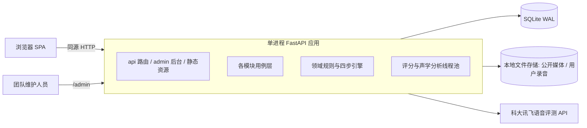

# 03 · 后端架构与实施方案

> 范围：1.0 后端的运行形态、分层与模块安排、关键业务流程、测试验证与 2.0/3.0 演进接口。业务需求以 [SRS](../srs/README.md) 为准，API 契约见 [后端决策图](../decision-map-backend.md)。

## 1. 总体运行形态



| 维度 | 方案 |
| ---- | ---- |
| 进程模型 | 单进程 FastAPI；异步 HTTP 路由 + 有界线程池执行音频转码、Praat 声学分析与外部评分调用 |
| 存储方案 | SQLite（开启 WAL 模式与外键约束）存储结构化数据；本地文件系统存储公开教学媒体与用户私有录音文件 |
| 开发与运行 | Python 环境使用 `py -3.13`；评分默认走真实讯飞语音评测 Provider，离线/测试时以 `SVS_PROVIDER=mock` 显式切换到本地测试替身 |

## 2. 技术选型

| 关注点 | 选型 | 说明 |
| ---- | ---- | ---- |
| Web 框架 | FastAPI + Pydantic v2 | 统一 camelCase JSON 响应与 OpenAPI schema 导出 |
| ORM | SQLAlchemy 2 | SQLite 持久化与事务管理 |
| 账号认证 | `argon2` 密码哈希 + 服务端会话表 | HttpOnly Cookie 会话认证，支持注册、登录、退出、修改方言/母语背景与注销账号 |
| 内容后台 | `starlette-admin` / `sqladmin` | 挂载于 `/admin`，供团队内部直接录入修改关卡、原理文章、媒体与查看反馈 |
| 音频规范化 | `ffmpeg` | 将浏览器上传的 `webm/opus` 或 `mp4/aac` 统一转码为 16kHz、单声道、16-bit PCM WAV，并计算 SHA-256 哈希 |
| 声学特征分析 | `parselmouth`（Praat）+ `numpy` | 提取基频（F0）序列、第一/第二共振峰（F1/F2）、送气段时域波形（VOT）及语谱图（Spectrogram） |
| 外部语音评测 | 科大讯飞流式语音评测 API（`websocket-client`） | 获取总分、声韵分、声调分、音节时间戳（10ms 帧）及声韵调检错信息（详见 [实测记录](../research/10-讯飞语音评测M0实测记录.md)） |
| 拼音处理 | `pypinyin` | 支持汉字搜索拆解声韵母映射至对应关卡 |

## 3. 分层与代码组织

```
backend/app/
  platform/      requestId、统一响应 envelope、错误处理、配置与定时任务
  content/       关卡（L01–L30）、原理文章与分类、公开媒体、搜索与导航
  acoustics/     音频上传、ffmpeg 转码、F0/共振峰/送气波形/语谱图提取与特征缓存
  scoring/       评分 Provider 适配（讯飞 + mock）、录音环境质量检测、规则引擎四步反馈、音域标定与 T 值换算、评分缓存
  detection/     录音状态机、短同步窗口与 202 异步执行编排、检测结果存储
  identity/      用户注册登录、会话认证、个人资料（含方言区/母语背景 dialectBackground）、账号注销
  archive/       个人声音档案查询、单删/清空、同关历史记录并排对比、学习事件与 D-24 进度计算
  feedback/      纠错反馈与「希望增加」提交与管理
  api/           FastAPI 路由与 OpenAPI 响应模型（schemas.py）
```

## 4. 关键业务流程

### 4.1 录音检测提交（短同步 + 超时回落 202）

1. **受理与幂等**：校验用户登录态与 `audioId` 归属；按 `(userId, submissionId)` 保证幂等（已完成则直接返回已有结果，处理中返回 `202`，可重试失败则重新执行）。**不强制要求前置标定**——若用户已完成音域标定则读取其个人音域，若未标定则标记使用默认/自适应范围。
2. **短同步等待**：任务投入后台线程池，HTTP 路由等待短同步窗口（默认约 8 秒，可通过 `SVS_SYNC_WINDOW` 配置）；窗口内完成直接返回 `200 {recording, result}`，否则返回 `202 {recording}`（含当前 `stage` 与 `Retry-After`）。
3. **评估与声学分析管线**：
   - `signal_check`：计算音量（RMS）、信噪比（SNR）、峰值截幅与有效时长，生成温和的录音环境改善建议（`quality.retakeAdvice`），**不中断后续评分与声学提取**；
   - `scoring`：查验评分缓存（同音频哈希 + 同关卡 + 同规则版本可复用，保证 KPI-2 分数可重复）；未命中时调用评分 Provider 获取维度分、音节起止时间戳与声韵调检错；
   - `analyzing`：使用 `parselmouth` 提取基频 F0 序列、共振峰 F1/F2、送气段波形（VOT）及语谱图；结合音节时间戳对齐用户曲线与参考标准曲线（已标定用户换算为五度 T 值并归一化元音空间，未标定用户采用自适应/默认参考范围）；结合声学参数与评测检错匹配规则引擎四步反馈；
   - `finalizing`：写入检测结果与评分缓存，自动归入用户声音档案（P10）。
4. **超时控制**：自受理起超过 30 秒仍未完成的任务标记为 `failed(retryable, TIMEOUT)`，支持前端使用同一 `submissionId` 重试。

### 4.2 个人音域与元音空间标定（可选）

1. 用户在 P05 录音区或 P11 账号页发起标定，朗读覆盖六个单韵母且带音高起伏的标定文本，上传 `purpose=calibration` 音频并调用 `POST /api/pitch-calibration`。
2. 后端提取有效有声段的 F0 百分位上下限作为个人音高音域，提取元音段 F1/F2 均值与标准差作为个人元音空间基线，保存至用户账号下。
3. 若音频过短或未检测到有效基频，返回 `200 CALIBRATION_FAIL` 及重录建议。

### 4.3 账号、方言背景与数据清理

- **注册与个人资料**：`POST /api/auth/register` 支持传入可选的 `dialectBackground`（方言区 / 母语背景）；已登录用户可通过个人资料接口或在 P11 账号页随时设置与更新该字段，`GET /api/me/context` 将其一并返回。
- **录音删除与账号注销**：单删录音（`DELETE /api/recordings/{id}`）或清空档案（`DELETE /api/me/recordings`）立即移除对应档案记录与音频文件；注销账号（`DELETE /api/me/account`）在验证当前密码后清空该账号的全部录音档案、声学特征、学习进度、音域数据及账号记录，并使当前会话失效。

## 5. 契约同步与验证命令

- **导出 OpenAPI 与生成前端类型**（修改 `backend/app/api/schemas.py` 后执行）：
  ```bash
  npm run api:dump && npm run api:types
  ```
- **检查前后端契约漂移**：
  ```bash
  npm run api:check
  ```
- **后端接口与端到端回归测试**：
  ```bash
  py -3.13 backend/test_openapi_shapes.py
  ```

## 6. 2.0 / 3.0 演进预留

| 演进方向 | 后端扩展方式 |
| ---- | ---- |
| 大模型四步话术（FR-1601） | 在 `scoring` 模块接入 LLM：将关卡目标、用户 `dialectBackground`（方言/母语背景）、评测检错标签与提取的物理声学参数（F0、F1/F2、VOT）组装为结构化 Prompt，生成个性化四步反馈文案；LLM 不可用时回落至 1.0 规则模板 |
| 个性化推荐（FR-1603） | 结合用户历史薄弱关卡、错题记录与 `dialectBackground` 常见易混音计算推荐关卡列表 |
| 专属纠音模型对比（FR-1604） | 在 `ScoringProvider` 协议下新增专属模型实现，支持同录音双模型对比 |
| 关卡与语流音变扩展（2.0/3.0） | 复用统一关卡表结构与多音节 `curve.segments` 分段对比能力，直接扩展复韵母、前后鼻音及双字词/短句变调关卡 |
