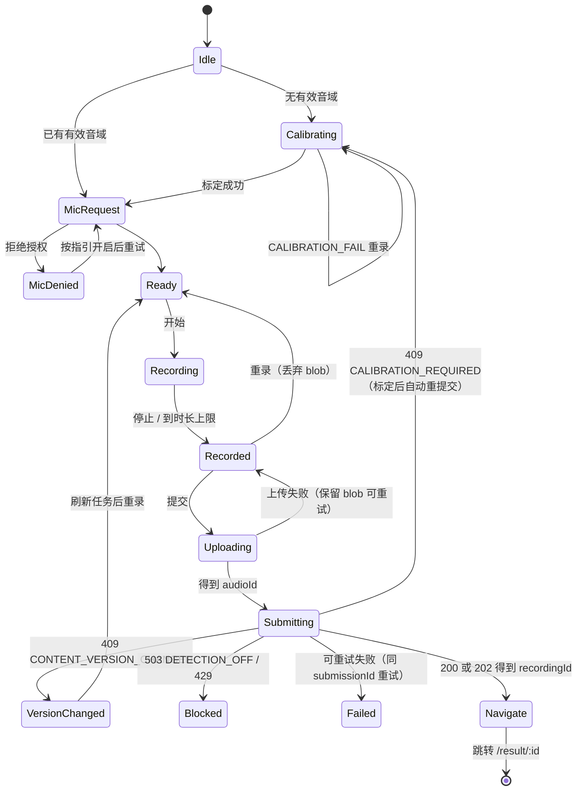
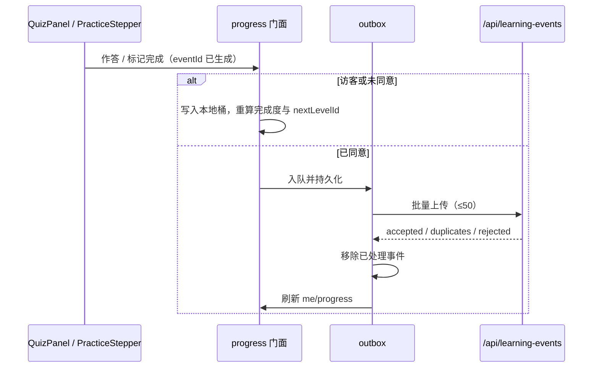

# 04 · 前端架构与实施方案

> 范围：1.0 大众端 SPA 的运行形态、分层与代码组织、状态模型、关键流程、API 与错误处理、兼容性、性能、测试策略和实施计划，并给出 2.0/3.0 演进位。业务以 [SRS](../srs/README.md) 为准，API 契约以 [后端决策图](../decision-map-backend.md) 为准，页面职责、组件清单与前端决策见 [前端决策图](../decision-map-frontend.md)。本文不含代码实现，也不断言任何依赖已验证。

## 1. 总体形态

```mermaid
flowchart LR
    subgraph Browser[浏览器]
        Pages[pages 页面容器] --> Features[features 业务流程]
        Pages --> Renderers[renderers 纯展示]
        Features --> Stores[stores 全局状态]
        Features --> Api[api 客户端]
        Stores --> Api
        Stores --> Local[(localStorage 本地进度 / outbox)]
        Features --> Media[MediaRecorder / Web Audio]
    end
    Api -->|同源 fetch + Cookie| Backend[/api]
    Renderers -->|audio/img src| MediaApi[/api/media /api/audio /api/preview/media]
```

| 维度 | 安排 |
| ---- | ---- |
| 交付物 | Vite 构建的静态 SPA，由后端同源托管于 `/`；后端对未知路径回落 `index.html` |
| 开发 | Vite dev server 代理 `/api` 到本地后端；后端未就绪时用 MSW 按 OpenAPI 模拟 |
| 认证 | 完全依赖 HttpOnly Cookie（sid、认证会话）；前端不持有任何令牌，预览令牌除外（只在 URL 中） |
| CSRF | 同源请求由浏览器自动带 Origin，后端校验；前端不加额外头 |
| 本地存储 | 只存学习进度与学习事件 outbox；不存音频、结果、音域与个人资料 |
| 浏览器 | Windows/macOS 的 Chrome、Edge、Safari；iOS Safari、Android Chrome（NFR-05/06） |

## 2. 技术选型

| 关注点 | 选型 | 说明 / 待验证 |
| ---- | ---- | ---- |
| 框架 | Vue 3 + TypeScript + Vite | 组合式 API；严格类型 |
| UI | Quasar v2（@quasar/vite-plugin、@quasar/extras、sass） | 须验证与当前 Vite 主版本的插件兼容；只按需引入组件 |
| 路由 | vue-router | history 模式，路由级懒加载 |
| 状态 | Pinia + composables | store 只放跨页共享状态；页面局部流程放 composable |
| 浏览器能力 | @vueuse/core | 可见性、网络状态、媒体查询、本地存储 |
| 图表 | echarts + vue-echarts（按需引入 line、scatter） | 只在 P09/P10 懒加载 |
| Markdown | markdown-it + 自定义容器指令 | 禁用 html；指令白名单 |
| 3D | three.js | 1.0 只建立懒加载占位，不进主包 |
| 类型 | openapi-typescript | 从后端导出的 OpenAPI 生成；CI 比对漂移 |
| 测试 | Vitest + Vue Test Utils、MSW、Playwright | 单元 / 组件 / 端到端 |
| 规范 | ESLint、Prettier、vue-tsc | 提交前与 CI 执行 |

## 3. 分层与代码组织

```
src/
  api/          generated/（openapi 类型）、client（fetch、envelope、错误类型、202/Retry-After）、
                endpoints（按后端模块分组的薄函数）、mediaUrl（媒体与 audioId 地址拼装）
  stores/       context、levels、progress（门面）、outbox、recorder、player
  features/     assessment（检测状态机）、calibration、result、consent、quiz、practice、
                compare、feedback、archive、session、auth
  renderers/    LevelView、ArticleView、ArticulationFigure、SagittalView、ToneCurveChart、FormantChart
  components/   AppShell、PageState、BoundaryNotice、LevelCard、DangerConfirmDialog 等通用件
  pages/        P01–P11 与 preview 页面容器
  copy/         usePageCopy 文案表（状态文案、错误码文案、边界句）
  router/       路由表、守卫（重定向、redirect 白名单、NotFound）
```

依赖规则：

- `renderers` 只接收 DTO 与回调，不调用 api、不读 store，因此公开页面与预览共用。
- `pages` 决定数据源（公开或预览）与可交互能力，把 features 与 renderers 组装起来。
- `features` 可以读写 stores 并调用 api；features 之间不互相引用内部状态，需要协作时经 store 或事件回调。
- 只有 `api/` 知道 URL、envelope 与状态码；其他层只处理类型化结果与类型化错误。
- 文案集中在 `copy/`，错误码到文案与下一步动作的映射只有一处。

## 4. 路由与页面装配

| 页面 | 主要 features / renderers | 守卫与特殊处理 |
| ---- | ---- | ---- |
| P01 `/` | LevelCard 列表、SearchBox、progress 门面、BoundaryNotice | 无已发布关时按钮为空状态 |
| P02 `/search` | SearchBox、LevelCard、WishDialog | q 写入 URL，可刷新、可后退 |
| P03 `/map` | LayerMap、ConfusablePairList、compare | `?compare=` 打开 ComparePanel |
| P04 `/principles/:slug?` | ArticleView、FeedbackWidget | 文章 404 落统一不可见状态 |
| P05 `/learn/:id` | LevelView、quiz、practice、assessment（内嵌）、FeedbackWidget、LevelNav | 进入时校验已发布；锚点滚动；404 时刷新 levels store |
| P06 `/library` | LevelCard、compare | 任选两关 |
| P08 `/test/:levelId?` | 选关列表、assessment | 无 levelId 时先选关；熔断关显示故障 |
| P09 `/result/:id` | result、ToneCurveChart、FormantChart、AcousticDetail、FeedbackWidget、SaveStatusBanner | 404 显示「记录已过期或不可见」 |
| P10 `/archive` | archive、session（未同意态） | 按 context 渲染三种态：访客、未同意、已同意 |
| P10 `/archive/compare` | ArchiveCompareView | 仅已同意 |
| P11 `/account/*` | auth、consent、session、calibration（重新标定） | 已登录访问 login/register 时转到 `/account` |
| `/preview/*` | LevelView / ArticleView（预览数据源） | 无 token 或失效显示提示；不渲染 AppShell 中的账号入口 |

所有页面首屏数据并行请求；levels 与 context 在应用启动时预取，路由切换不阻塞已有缓存的渲染（NFR-01）。

## 5. 状态模型

| Store | 内容 | 持久化 | 刷新时机 |
| ---- | ---- | ---- | ---- |
| context | authenticated、accountId、username、consent、calibration、dataEpoch、pendingTransfer、nextLevelId | 不持久化 | 启动、登录、退出、注册后登录、同意变化、注销、标定完成、窗口重新可见、收到 401 或 403 CONSENT_REQUIRED |
| levels | 摘要、骨架、易混对、availability、completionKeys | 不持久化 | 启动；路由切换与窗口可见时后台重新校验（先用缓存渲染） |
| progress 门面 | 当前身份对应的完成集合与 nextLevelId | 访客桶与账号桶在 localStorage | 身份变化、学习事件产生、outbox 上传成功 |
| outbox | 待上传学习事件 | localStorage，键含 accountId 与 dataEpoch | 事件产生；联网、可见、路由切换时尝试上传 |
| recorder | 麦克风授权、MediaRecorder、分析节点、当前 blob | 不持久化 | 进入或离开录音组件；离开时释放麦克风 |
| player | 当前播放源与状态 | 不持久化 | 任意播放请求会停止上一个 |

身份切换规则（与后端 sid 轮换一致）：

| 事件 | 前端动作 |
| ---- | ---- |
| 登录成功 | 用响应中的 context 替换；清除上一账号的内存状态；弹出同意（未处理时）；展示 transfer |
| 退出 | 清除账号桶、outbox 与全部账号内存状态；重新拉 context；回到访客桶 |
| 同意 | 清除账号桶；刷新 context 与进度；展示 transfer |
| 撤回 / 注销 | 清除该账号全部本地数据；刷新 context；注销后回到首页 |
| dataEpoch 变化 | 清除旧代次的账号桶与 outbox |

## 6. 关键流程

### 6.1 启动

1. 并行请求 `/api/me/context` 与 `/api/levels`。
2. 按 context 校验本地存储：清理与当前 accountId/dataEpoch 不符的账号数据。
3. 已同意时请求 `/api/me/progress` 并尝试上传 outbox；否则由本地桶与 completionKeys 计算进度。
4. 渲染当前路由；context 请求失败时以访客态渲染公开内容，并在需要身份的操作处提示重试。

### 6.2 检测流程（P05 内嵌与 P08 共用）



- 一次录音生成一个 submissionId（客户端 UUID），与 audioId 一起保存在流程内存中，直到跳转或重录。
- 上传与提交期间禁用按钮，防止重复提交；有未提交录音时 beforeunload 提示。
- 录音时长上限按用途设置（建议关卡 15 秒、标定 40 秒），到上限自动停止；最短时长不在前端拦截，由后端质量检查给出「太短」结论。
- 进入流程前展示 RecordingTips（安静环境、麦克风距离、默认临时处理、保存需同意）。

### 6.3 标定

CalibrationPanel 以对话框形式嵌入检测流程，也可从 P11 主动打开。流程：读取标定文本与 textVersion → 录音（复用 recorder）→ 上传 purpose=calibration → POST 标定 → 成功刷新 context 并回到原检测流程；CALIBRATION_FAIL 显示原因与重录指引；网络或服务失败保留 blob 可重试。由检测流程触发的标定，在关闭对话框后回到 Idle，不允许跳过直接录音。

### 6.4 结果读取（P09）

1. 读取 `/api/recordings/{id}`。200 渲染结果；202 显示 ProcessingStage，并按 Retry-After（缺省 2 秒）轮询；页面隐藏时暂停，恢复可见时立即查询。
2. 从提交页面跳转而来时，流程把 submissionId 与负载通过内存传给 P09，可重试失败显示「重试」；直接打开或刷新时只显示「重新录音」，跳到 `/learn/:levelId#record` 或 `/test/:levelId`。
3. 质量不合格只渲染 QualityVerdict 与重录指引；合格时依次渲染分数、现象、曲线、共振峰（单韵母关）、四步、边界句。
4. 回放使用 `/api/audio/{audioId}/file`；AcousticDetail 展开时才请求 `/f0`、`/formants`、`/formants.png`。
5. storage=session 时 SaveStatusBanner 显示到期时间与登录或同意入口；登录或同意后刷新本记录状态。

### 6.5 学习事件与进度



已同意用户在上传完成前，界面先按乐观合并（服务端进度 + outbox 中未上传事件）显示完成状态，避免答题后进度短暂回退。

### 6.6 登录、同意与转存

1. 登录页提交后，用响应中的 context 替换当前 context；redirect 只接受站内路径。
2. consent.status 为 none 时弹出 ConsentDialog：读取 `/api/session/recordings` 的将转存条数，说明自动转存范围、72 小时期限、删除范围与本地进度不导入。
3. 同意 → `POST /api/me/consent`，依据 transfer 展示提示；partial 提供重试。拒绝 → 记录决定，不再自动弹出。暂不 → 不调用接口。
4. 已有同意的账号登录时，后端直接返回 transfer，前端只展示提示。

### 6.7 删除、撤回与注销

均使用 DangerConfirmDialog 二次确认；撤回文案写明删除录音、结果、学习进度与音域；注销要求输入密码。成功后按第 5 节清除本地数据并刷新 context；P10 回到无档案说明。删除单条后从列表移除并刷新音域相关展示（context.calibration）。

### 6.8 预览

预览页面从 query 读取 token，所有预览请求带上同一 token；媒体地址由 `mediaUrl` 统一改写为预览地址。预览容器向 LevelView/ArticleView 传入只读能力：不挂载 assessment、不产生学习事件、不显示反馈。401/403/404 统一显示「预览已失效，请回后台重新打开」。

### 6.9 内容新鲜度（NFR-11）

levels store 在路由切换与窗口可见时后台重新校验；详情或媒体 404 时立即刷新 levels store 并显示不可见状态。公开媒体由后端 `no-cache` + ETag 控制，前端不做额外缓存。

## 7. API 层与错误处理

客户端统一行为：`credentials: 'same-origin'`；解析 envelope；把 `code` 映射为类型化错误；保留 requestId 与 nextStep；202 与 429 读取 Retry-After。

| 状态 / code | 前端处理 |
| ---- | ---- |
| 200 QUALITY_FAIL | 结果页「本次不能评」与重录指引 |
| 200 CALIBRATION_FAIL | 标定面板原因与重录 |
| 202 PROCESSING | ProcessingStage + 轮询 |
| 400 DECODE_FAILED | 「没录上」，重录 |
| 401 AUTH_REQUIRED | 刷新 context，跳登录并带 redirect |
| 401 INVALID_CREDENTIALS | 表单内错误，提示不提供找回 |
| 403 CONSENT_REQUIRED | 刷新 context，显示同意入口 |
| 404 / LEVEL_NOT_PUBLISHED | 统一不可见状态；刷新 levels |
| 409 CONTENT_VERSION_CHANGED | 刷新任务，提示按新内容重录 |
| 409 CALIBRATION_REQUIRED | 进入标定，成功后自动重提交 |
| 409 IDEMPOTENCY_CONFLICT | 视为客户端缺陷：重新生成 submissionId 并提示重提交 |
| 409 USERNAME_TAKEN | 注册表单内错误 |
| 413 FILE_TOO_LARGE | 提示录音过长，重录 |
| 429 RATE_LIMITED | 倒计时后可重试 |
| 502 PROVIDER_ERROR / 503 PROVIDER_DOWN | 「评分服务异常」，可重试 |
| 503 DETECTION_OFF | 检测暂停说明，保留学习入口 |
| 503 SERVER_BUSY | 「当前排队较多」，按 Retry-After 重试 |
| 504 TIMEOUT | 「处理超时」，提交页面内可重试，否则重新录音 |
| 500 / 网络错误 | 通用错误 + requestId + 重试 |

## 8. 录音与媒体兼容性

| 事项 | 安排 |
| ---- | ---- |
| 格式 | 按 `MediaRecorder.isTypeSupported` 依次选择 webm/opus、mp4/aac；均不支持时显示浏览器不支持说明 |
| 采集参数 | 关闭回声消除、降噪与自动增益（若浏览器允许），避免改变音高与能量；须真机验证效果 |
| iOS Safari | 录音与播放均在用户手势内启动；AudioContext 在首次手势时 resume；后台切换会中断录音，回到前台提示重录 |
| 麦克风拒绝 | MicPermissionGuide 按 Chrome / Edge / Safari / iOS / Android 分别说明开启路径 |
| 播放 | player store 保证同一时刻只播一个；示范、题干、回放、比较共用；≤2 秒开始播放或给出失败原因（NFR-02） |
| 释放 | 离开录音组件或页面隐藏超过一定时间时停止所有轨道，避免麦克风指示常亮 |

## 9. 性能与包体

- 首屏包只含 Quasar 按需组件、路由、api、stores 与 P01；其他页面路由级拆包。
- echarts（P09/P10）、markdown-it（P04、预览）、three.js（3D 视图）、SagittalView 动画单独分包。
- 预算（建议，实现期校准）：首屏 JS gzip ≤ 250 KB；常规网络下 2 秒内可操作首屏，超过 3 秒显示加载状态（NFR-01）。
- 图片与动画使用 CMS 提供的尺寸，懒加载非首屏媒体；音频 `preload="none"`，点击后加载。

## 10. 可达性与文案

- 所有音频有对应文字（字幕或朗读文本）；构形图与剖面有 altText 与帧说明（NFR-07）。
- 曲线中「我的曲线」与「标准曲线」用实线与虚线加图例区分，不只靠颜色；质量结论、分数区间与可比性提示均配图标与文字。
- 触控目标不小于 44×44 px；录音主按钮在手机端固定在可触达区域。
- 文案集中在 `copy/`：页面状态文案、错误码文案、边界句「学习参考，不作为普通话等级认定或医学诊断」、同意与撤回说明。现象、四步等内容文案来自后端，不在前端改写。

## 11. 测试策略

| 层次 | 内容 |
| ---- | ---- |
| 单元 | 完成度计算（D-24）与 nextLevelId；本地桶与 dataEpoch 清理；outbox 批量与去重；检测状态机迁移；错误码映射；剖面关键帧插值；Markdown 指令白名单 |
| 组件 | 各 renderer 以固定 DTO 快照渲染；PageState 全状态；ConsentDialog 三种选择；RecorderPanel 以模拟 MediaRecorder 驱动 |
| 契约 | 生成类型与后端 OpenAPI 比对（CI）；MSW 处理器基于生成类型编写，后端字段变化时编译失败 |
| 端到端 | Playwright 对接测试替身后端，每条涉及前端的 V1-AC 一个脚本：AC02、03、06、07、08、09、12、15、18、20、22、23、24、27、28、29、30、31 |
| 真机 | NFR-05/06 矩阵走主路径：学习、标定、录音、P09、登录同意转存、撤回；拒绝麦克风、提交失败、超过 30 秒三种异常 |
| 可达性 | 自动检查 + 人工核对颜色无关区分与替代文本 |

## 12. 实施计划（距 1.0 冻结 2026-10-27）

假设两条前端并行线（A：内容与学习侧；B：检测与账号侧），与后端 M0–M5 对齐。后端 OpenAPI 草案在 10-16 前给出，之前前端以本文与后端决策图为准写 MSW 模拟。

| 阶段 | 日期 | 交付 | 出口条件 |
| ---- | ---- | ---- | ---- |
| F0 基座 | 10-14 ~ 10-16 | 工程骨架、Quasar、路由表与守卫、api 客户端与错误映射、类型生成流水线、MSW、AppShell（桌面 / 手机）、PageState、copy、context 与 levels store；**iOS Safari 录音探路**（格式、采集参数、手势限制） | 10-16 给出录音兼容性结论；以模拟数据能在两端打开全部路由 |
| F1 学习侧（A） | 10-16 ~ 10-20 | P01、P02、P03、P06、P04（ArticleView）、P05 学习部分（LevelView、ArticulationFigure 媒体视图、SagittalView、DemoPlayer、QuizPanel、PracticeStepper、LevelNav、ComparePanel）；progress 门面与本地桶 | 访客清缓存后完成一关学习并得到正确 nextLevelId |
| F2 检测（B） | 10-16 ~ 10-21 | recorder、player、CalibrationPanel、useAssessmentFlow、P08、P05 录音区、P09（结果全部区块、轮询、回放、AcousticDetail、ToneCurveChart、FormantChart） | 用测试替身后端走通标定 → 录音 → 202 → 结果，以及质量不合格与超时 |
| F3 账号档案（B） | 10-19 ~ 10-22 | P11 登录注册、ConsentDialog 与转存提示、SessionRecordsPanel、outbox、dataEpoch 清理、P10 列表与比较、删除 / 清空 / 撤回 / 注销 | 访客 → 登录 → 同意 → 转存 → P10 比较全链路 |
| F4 预览、反馈与加固（A） | 10-20 ~ 10-23 | 预览路由、FeedbackWidget、WishDialog、熔断与不可见状态、包体拆分、可达性检查 | 后台可打开真实预览；首屏包达标 |
| F5 联调与验收 | 10-23 ~ 10-26 | 对接真实后端、契约漂移清零、端到端脚本全量、真机矩阵、真实内容走查 | 前端相关 V1-AC 全绿或有书面豁免 |
| 冻结 | 10-27 | 1.0 冻结 | — |

**关键路径**：契约草案（10-16）→ 检测流程与 P09（F2）→ 真实 Provider 联调（M5）→ 真机验收。iOS 录音一旦有问题，影响 KPI-3，所以放在 F0 探路。

**风险与预案**：

| 风险 | 预案 |
| ---- | ---- |
| iOS Safari 录音格式或采集参数异常 | 后端负责转码；若关闭处理选项无效，保留默认采集并在验收中记录对曲线的影响 |
| 契约在联调期变动 | 类型生成 + CI 漂移检查；变动集中在 api/endpoints，渲染层只依赖 DTO |
| 声道剖面绘制工作量超出 | 先交付静态单帧与基础插值，过程动画与气流动效后补；剖面视图仍属 1.0 必做，不能整体缺席 |
| 真实内容晚到 | 用固定样例关卡（L01、L07、L30）开发与验收结构；内容到位后只做走查 |
| 时间不足 | 可后移：AcousticDetail 原始特征折叠区、P10 主要差异的展示打磨、3D 占位以外的工作、FR-1104 趋势。不可后移：标定与检测闭环、P09 结果、同意 / 转存 / 撤回、本地进度规则、预览 |

## 13. 2.0 / 3.0 演进

| 需求 | 前端落点 |
| ---- | ---- |
| 问题标签分流（FR-1607/1702） | 首页标签选择写入 URL 查询参数，levels/search/articles 透传 `tag`；通用路径不变 |
| 个性化推荐（FR-1603） | progress 门面的 nextLevelId 改读 `GET /api/me/recommendations`，接口不变时组件无需改动 |
| 小测（FR-607） | 新增 MiniQuizPanel，事件 kind 增加 mini_quiz，完成度规则随 SRS 扩展 |
| 大模型话术（FR-1601） | FourStepsList 按 wordingSource 展示，规则模板与确认话术同一结构 |
| 新关卡层与易混声调（FR-1605/1606） | LayerMap 按 layer 数据渲染，不写死三层；曲线已按音节分段 |
| 3D 构形 | ArticulationFigure 的 3D 视图接入 three.js 加载 model3dMediaId |
| 3.0 变调、IPA | ProFold 与 ArticleView 增加内容块；ToneCurveChart 多音节 segments 已支持 |

## 14. 未决与待验证

- Quasar v2 与当前 Vite 主版本、@quasar/vite-plugin 的兼容性。
- iOS Safari 与 Android Chrome 的 MediaRecorder 格式、关闭降噪 / 自动增益的实际效果（F0 探路产出结论）。
- 声道剖面底图与各器官控制点的美术稿，需与内容方确认预设帧取值。
- 录音时长上限与后端上传上限的具体数值。
- 首屏包体预算在真实依赖下的可达性。
