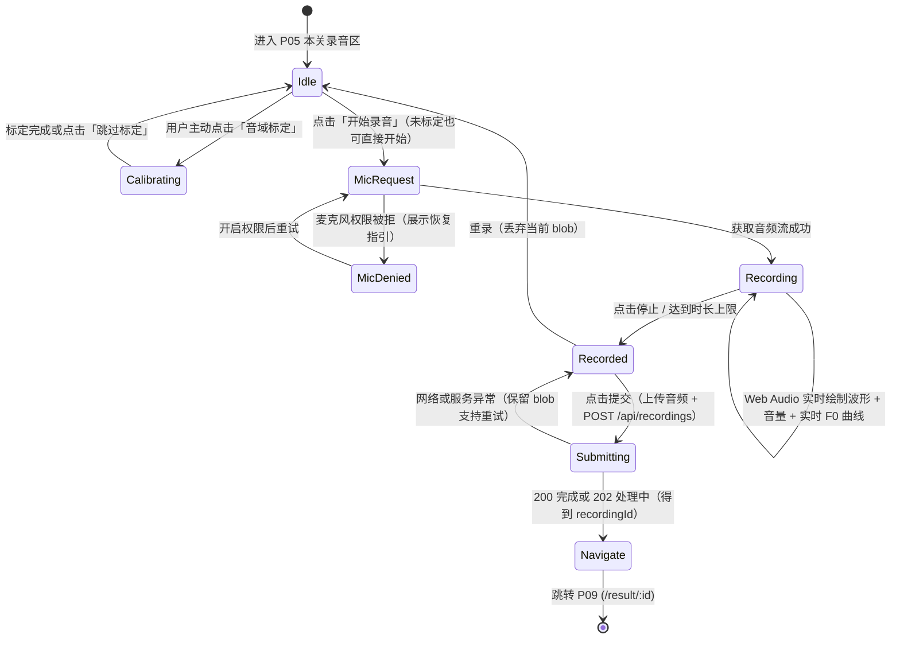

# 04 · 前端架构与实施方案

> 范围：1.0 大众端 SPA 的运行形态、分层与代码组织、状态模型、关键流程（含录音端实时声学反馈）、兼容性与测试策略。业务需求以 [SRS](../srs/README.md) 为准，API 契约见 [后端决策图](../decision-map-backend.md)，页面与组件清单见 [前端决策图](../decision-map-frontend.md)。

## 1. 总体形态

```mermaid
flowchart LR
    subgraph Browser[浏览器 SPA]
        Pages[pages 页面容器 P01-P06 / P09-P11] --> Features[features 业务流程]
        Pages --> Renderers[renderers 可视化与展示组件]
        Features --> Stores[stores 全局状态]
        Features --> Api[api 客户端]
        Features --> Media[MediaRecorder + Web Audio 实时声学分析]
        Media --> Renderers
    end
    Api -->|同源 fetch + Cookie| Backend[/api]
    Renderers -->|audio / img / model| MediaApi[/api/media /api/audio]
```

| 维度 | 方案 |
| ---- | ---- |
| 交付形态 | Vite 构建的 Vue 3 + TypeScript 静态 SPA，与后端 `/api` 同源部署 |
| 开发联调 | Vite dev server 代理 `/api` 到本地后端（`127.0.0.1:8000`）；支持 `npm run dev:mock` 使用 MSW 离线联调 |
| 认证机制 | 依赖服务端 HttpOnly Cookie 会话；注册并登录即默认同意服务条款，学习进度与录音档案自动保存至个人账号 |
| 跨端支持 | 桌面端（Windows / macOS 的 Chrome、Edge、Safari）与移动端（iOS Safari、Android Chrome）响应式布局 |

## 2. 技术选型

| 关注点 | 选型 | 说明 |
| ---- | ---- | ---- |
| 核心框架 | Vue 3 + TypeScript + Vite | 组合式 API，路由级懒加载 |
| UI 组件库 | Quasar v2 | 响应式布局（桌面顶栏 + 手机底栏）与基础交互控件 |
| 状态管理 | Pinia + Composables | Store 管理跨页状态（用户信息、关卡列表、进度、播放器），Composable 管理局部业务流 |
| 实时声学可视化 | Web Audio API + HTML5 Canvas | 录音过程中使用 `AnalyserNode` / `AudioWorklet` 实时提取并绘制时域波形、音量包络（RMS）与实时基频（F0）轨迹 |
| 事后对比图表 | `echarts` + `vue-echarts` | 在 P09 结果页与 P10 档案页渲染基频（F0）对比曲线、元音空间共振峰（F1/F2）图 |
| 2D / 3D 构形 | SVG / Canvas + `three.js` | `SagittalView` 按关键帧参数插值绘制 2D 声道剖面；3D 视图按需懒加载 `three.js` |
| 文章渲染 | `markdown-it` | P04 发音原理文章 Markdown 渲染（禁用原始 HTML 脚本） |
| 契约类型 | `openapi-typescript` | 从后端 OpenAPI 自动生成 `src/api/generated/schema.d.ts` |
| 测试工具 | Vitest + Vue Test Utils + MSW | 单元测试与组件测试 |

## 3. 分层与代码组织

```
src/
  api/          generated/（OpenAPI 生成类型与转发层）、client.ts（fetch 与 envelope 解析）、
                endpoints/（按模块分组的 API 调用）、mediaUrl.ts（媒体与音频 URL 拼装）
  stores/       context（用户身份、方言/母语背景、标定状态）、levels、progress、recorder、player
  features/     assessment（P05 录音与提交状态机）、calibration（可选音域标定）、result、
                quiz、practice、compare、feedback、archive、auth
  renderers/    LevelView、ArticleView、ArticulationFigure、SagittalView、
                RealtimeAcousticCanvas（实时声学画布）、ToneCurveChart、FormantChart
  components/   AppShell、PageState、LevelCard、RecorderPanel、CalibrationPanel、
                QualityVerdict、DialectSelector、ArchiveList、DangerConfirmDialog 等
  pages/        P01–P06、P09–P11 页面容器
  copy/         usePageCopy 统一状态与错误提示文案
  router/       路由表与登录守卫
```

## 4. 关键业务流程

### 4.1 关卡内录音与前端实时声学反馈（P05）



- **音域标定可跳过（D-20）**：未标定用户在 P05 录音区可随时点击「去标定」完成个人音域与元音空间标定，也可直接点击「跳过标定 / 开始录音」进行本关录音检测。
- **前端实时声学反馈实现（FR-907、NFR-18）**：
  1. 获取麦克风 `MediaStream` 后，同时连接 `MediaRecorder`（录制音频文件）与 `AudioContext` -> `MediaStreamAudioSourceNode` -> `AnalyserNode`（或 `AudioWorkletNode`）。
  2. 使用 `requestAnimationFrame` 驱动 `RealtimeAcousticCanvas` 渲染（目标 ≥30 fps）：
     - **实时波形与音量指示**：读取时域采样数据计算瞬时 RMS 能量与峰值，绘制动态声波与音量条，当音量过低或接近截幅爆音时给出即时视觉颜色提示。
     - **实时音高（F0）轨迹**：对当前音频帧执行时域基频检测（如自相关 / YIN / McLeod Pitch Method），在有声段（周期性显著且能量高于静音阈值）提取实时基频 Hz 值，经中值滤波与平滑后在画布上绘制随时间滚动的音高曲线；清辅音或静音段自然留空。
  3. 离开录音组件或停止录音时及时断开音频节点并释放麦克风轨道，避免设备麦克风指示灯常亮。

### 4.2 检测结果展示（P09）

1. 进入 `/result/:id` 后请求 `GET /api/recordings/{id}`：若返回 `202 PROCESSING`，展示当前处理阶段（`ProcessingStage`）并按 `Retry-After` 轮询；若返回 `200 OK`，渲染完整检测结果。
2. **非阻断式录音质量提示（FR-1001）**：当 `result.quality` 提示音量偏小、环境底噪偏大或截幅时，在页面顶部展示温和的环境改善建议横幅（`QualityVerdict`），同时下方正常展示本次评分、声学对比图表与四步反馈。
3. **多维声学可视化对比（FR-1005）**：
   - 韵母、声调与拼读关重点展示**基频（F0）对比曲线**（`ToneCurveChart`，叠加展示用户曲线与标准参考曲线）与**元音空间共振峰（F1/F2）图**（`FormantChart`）；
   - 声母关与全部关卡支持查看**送气段波形（VOT）与语谱图**（`/api/audio/{audioId}/spectrogram.png`）及原始声学特征明细（`AcousticDetail`）。
4. **四步反馈与行动闭环（FR-1007、FR-1008）**：展示「现象 → 可能相关环节 → 可感知提示 → 安全短练习」，点击短练习可直接跳回 `/learn/:levelId#step-{stepId}` 对应步骤；提供标准示范播放、本人录音回放与一键重录入口。

### 4.3 账号、方言/母语背景与声音档案（P10 / P11）

- **注册、登录与方言/母语背景（FR-107）**：在注册页（`/account/register`）及账号页（P11 `/account`）提供可选的「方言区 / 母语背景」选择器（`DialectSelector`），保存后同步更新 `context` store。
- **声音档案与并排对比（P10）**：自动展示用户名下按关卡归档的历史录音列表；支持在同一关下勾选两条历史记录进入 `/archive/compare?a=&b=`，并排回放两次录音并同屏对比基频曲线与分数变化；支持随时删除单条录音、清空全部档案或在 P11 验证密码注销账号。

## 5. 录音与跨端兼容性保障

| 事项 | 处理策略 |
| ---- | ---- |
| 录音格式探测 | 按 `MediaRecorder.isTypeSupported` 依次选用 `audio/webm;codecs=opus`、`audio/mp4`（iOS Safari），后端统一用 `ffmpeg` 转码 |
| 采集参数优化 | 请求麦克风流时尽量关闭浏览器自动增益（`autoGainControl: false`）、降噪（`noiseSuppression: false`）与回声消除（`echoCancellation: false`），保留真实语音能量与频谱特征 |
| iOS Safari 手势限制 | `AudioContext.resume()` 与录音/播放均在用户点击手势回调中触发 |
| 视觉可达性 | 图表中「我的曲线」与「标准参考曲线」同时采用颜色与实线/虚线图例区分（NFR-07）；手机端核心录音与播放按钮满足 ≥44×44 px 触控尺寸 |
