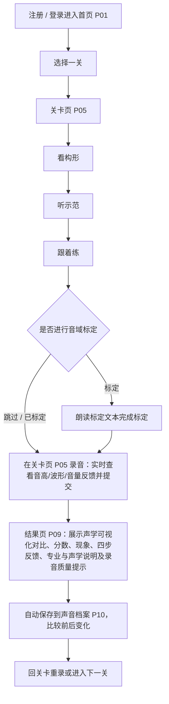

# 软件需求规格说明书

| 项    | 内容                                                         |
| ---- | ---------------------------------------------------------- |
| 产品迭代 | 1.0（冻结 2026-10-27）、2.0（冻结 2027-01-15）、3.0（冻结 2027-04-15）   |

## 文件导读

| 文件                                   | 内容                                             |
| ------------------------------------ | ---------------------------------------------- |
| [01-用户与定位.md](01-用户与定位.md)           | 背景、产品定位、建设目标、用户角色与画像                           |
| [02-内容模型与信息架构.md](02-内容模型与信息架构.md)   | 学习上下文、业务锚点、核心对象、关卡清单、页面结构与导航、关卡字段与结构定义         |
| [03-功能-学习侧.md](03-功能-学习侧.md)         | 首页与各页面、搜索、发音地图、发音原理（博客式子站）、关卡页（学习与录音一体）、发音库、反馈 |
| [04-功能-账号检测与档案.md](04-功能-账号检测与档案.md) | 账号、关卡内录音与实时声学反馈、检测结果与可视化、声音档案、录音质量提示、录音字段      |
| [05-功能-CMS与治理.md](05-功能-CMS与治理.md)   | 关卡与文章的团队自用后台维护、媒体上传与反馈查看                       |
| [06-功能-2.0-3.0.md](06-功能-2.0-3.0.md) | 版本总表、2.0 / 3.0 功能                              |
| [07-非功能与UI约束.md](07-非功能与UI约束.md)     | 性能、兼容性、可靠性、弱网、UI 状态与反馈                         |
| [08-验收与卡点.md](08-验收与卡点.md)           | KPI、分版本验收条目、必测场景、上线门槛                          |

## 业务（D）

| 编号   | 定案事项       | 结论                                                                                       |
| ---- | ---------- | ---------------------------------------------------------------------------------------- |
| D-01 | 产品边界       | 面向普通话发音学习。                                                                               |
| D-02 | 用户分流       | 1.0 面向大众普通话学习者。普通话考试 / 职场用户进入 2.0，对外汉语路径进入 3.0。                                          |
| D-03 | 页面结构       | 1.0 页面为 P01–P06、P09–P11，共 9 页，每页承载真实内容；关卡学习与录音检测均在 P05 完成。页面数量可随版本扩展，新页面从 P12 起编号。       |
| D-04 | 1.0 关卡     | 6 个单韵母 + 23 个声母（21 + y + w）+「妈」拼读（m+a 及 mā/má/mǎ/mà）。                                    |
| D-05 | 1.0 检测     | 所有已开放关均可在关卡页（P05）内完成学习与录音打分，并在录音过程中提供前端实时声学反馈。                                           |
| D-06 | 1.0 模型     | 评分调用外部普通话评分服务，结合本地声学特征提取与规则引擎四步反馈跑通闭环。                                                   |
| D-07 | 检测结果       | 结果 = 声学可视化对比 + 分数 + 现象 + 规则引擎四步反馈 + 录音质量提示；分数在 P09 可见、同规则可重复。                            |
| D-08 | 账号         | 用户注册并登录后使用系统，默认登录即同意服务条款；支持选填「方言区 / 母语背景」；学习进度与录音结果自动保存至个人账号；支持删除个人录音与注销账号，远期支持通过邮箱找回密码。 |
| D-09 | CMS        | 1.0 提供团队自用的简单内容维护后台，方便维护人员直接录入与修改关卡、文章及媒体，不设复杂鉴权与审核流。                                    |
| D-10 | 冻结日        | 1.0 = 2026-10-27；2.0 = 2027-01-15；3.0 = 2027-04-15。                                      |
| D-11 | 2.0 范围     | 大模型四步话术（结合用户方言/母语背景与声学特征）、个性化推荐、考试 / 职场问题标签分流（沿用同一套页面）、专属纠音模型与通用评分对比、复韵母与鼻韵母等关卡内容扩展。     |
| D-12 | 3.0 范围     | IPA、变调（含双字词与短句）、音位变体、对外汉语路径。                                                             |
| D-13 | 小测与完成度     | 关卡小测属于 2.0（FR-607）；1.0 关卡完成度由本关的录音检测提交派生。                                                  |
| D-17 | 录音删除与注销    | 用户可随时删除单条录音或清空声音档案；注销账号时清空该账号全部录音、档案、学习进度与音域数据。                                          |
| D-18 | HTTP 契约    | JSON 使用标准 HTTP 状态码与统一响应体；文件、Range、缓存响应遵循 HTTP 原生语义；requestId 可追溯。                        |
| D-19 | 检测处理       | 短同步 + 超时回落：短时间内完成即返回结果；否则返回「处理中」并展示处理阶段，后台继续评分、可查询；自受理起 30 秒未完成判失败，可用同一提交重试且不重复建档。       |
| D-20 | 音域标定       | 提供音域标定引导以支持个人音高与元音空间换算，同时允许用户跳过标定直接录音检测；跳过标定时仍正常评分并展示可用声学图像。                             |
| D-24 | 1.0 关卡完成判定 | 一关「已完成」= 该账号在本关至少提交过一次录音检测。下一关 = 顺序中第一个未完成的关卡，全部完成时回落第一关。                      |

## 核心业务闭环

用户的标准路径；任一已开放关卡均在 P05 提供学习与录音检测。

## 需求 ID 规则

| 前缀 | 含义 | 示例 |
| ---- | ---- | ---- |
| D- | 已锁定业务决策 | D-05 |
| FR- | 功能性需求 | FR-101 |
| NFR- | 非功能性需求 | NFR-01 |
| KPI- | 成功指标 | KPI-3 |
| V1-AC / V2-AC / V3-AC | 分版本验收条目 | V1-AC06 |
| P01 起顺序编号 | 页面对象 | P09 |
| L01–L30 | 关卡对象 | L30 |

## 文档职责

文档优先级：本目录 SRS 为业务基线。HTTP 契约真源为后端 `backend/app/api/schemas.py`（经 `/openapi.json` 暴露），前端契约由 openapi-typescript 生成 `src/api/generated/schema.d.ts` 并以 `npm run api:check` 校验漂移；提交的 `src/api/generated/openapi.json` 为契约比对锚点。API 路径指 HTTP 端点，不新增独立网络监听端口。
