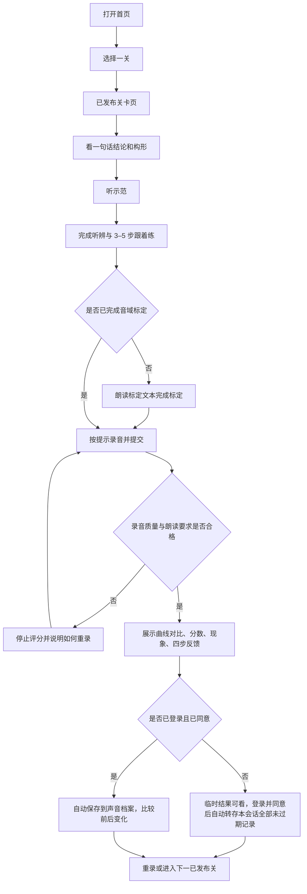

# 看得见的声音 · 软件需求规格说明书

| 项 | 内容 |
| ---- | ---- |
| 产品迭代 | 1.0（冻结 2026-10-27）、2.0（冻结 2027-01-15）、3.0（冻结 2027-04-15） |
| 文档结构 | 本规格拆分为 9 个文件；需求 ID（FR / NFR / KPI / V-AC）全局唯一，跨文件引用一律使用 ID |

## 文件导读

| 文件 | 内容 |
| ---- | ---- |
| [01-用户与定位.md](01-用户与定位.md) | 背景痛点、产品定位、建设目标、用户角色与画像 |
| [02-内容模型与信息架构.md](02-内容模型与信息架构.md) | 学习上下文、业务锚点、核心对象、30 关清单、页面结构与导航、关卡字段 |
| [03-功能-学习侧.md](03-功能-学习侧.md) | 首页与各页面、搜索、发音地图、发音原理（博客式子站）、关卡页、发音库、反馈 |
| [04-功能-账号检测与档案.md](04-功能-账号检测与档案.md) | 账号与同意、账号页、检测中心与录音、检测结果与可视化、声音档案、录音质量检查、录音字段 |
| [05-功能-CMS与治理.md](05-功能-CMS与治理.md) | 关卡治理、发布与检测任务要求、CMS 关卡与文章管理、状态机 |
| [06-功能-2.0-3.0.md](06-功能-2.0-3.0.md) | 版本总表、2.0 / 3.0 功能 |
| [07-非功能与UI约束.md](07-非功能与UI约束.md) | 性能、兼容性、隐私、可靠性、安全、弱网、审计、UI 状态与反馈 |
| [08-验收与卡点.md](08-验收与卡点.md) | KPI、分版本验收条目、必测场景、上线门槛 |

## 业务定案（D）

| 编号 | 定案事项 | 结论 |
| ---- | ---- | ---- |
| D-01 | 产品边界 | 只做普通话发音学习。 |
| D-02 | 用户分流 | 1.0 面向大众普通话学习者。普通话考试 / 职场用户进入 2.0，对外汉语路径进入 3.0。 |
| D-03 | 页面结构 | 1.0 页面为 P01–P06、P08–P11，共 10 页，每页承载真实已发布内容；参考资料位于 P04 文章与 P05 专业折叠区。页面数量可随版本扩展，新页面从 P12 起编号。 |
| D-04 | 1.0 关卡 | 6 个单韵母 + 23 个声母（21 + y + w）+「妈」拼读（m+a 及 mā/má/mǎ/mà），合计 30 关（L01–L30）。 |
| D-05 | 1.0 检测 | 所有已发布关均可录音打分，学习与检测随关卡一同发布。 |
| D-06 | 1.0 模型 | 评分调用外部普通话评分服务，结合规则引擎四步反馈跑通闭环。 |
| D-07 | 检测结果 | 结果 = 曲线对比 + 分数 + 现象 + 规则引擎四步反馈；分数在 P09 可见、同规则可重复。 |
| D-08 | 账号 | 可不登录先学；登录并同意后自动保存进度 / 录音；登录并同意后自动转存当前绑定会话中全部未过期临时录音与结果；未登录或未同意的进度仅存前端本地；撤回时删除录音、学习进度与音域。 |
| D-09 | CMS | 1.0 必做录入、发布 / 下架与版本管理，由单一管理员操作。 |
| D-10 | 冻结日 | 1.0 = 2026-10-27；2.0 = 2027-01-15；3.0 = 2027-04-15。 |
| D-11 | 2.0 范围 | 大模型四步话术（须管理员确认）、个性化推荐、考试 / 职场问题标签分流（沿用同一套页面）、专属纠音模型与通用评分对比、复韵母与鼻韵母等关卡内容扩展。 |
| D-12 | 3.0 范围 | IPA、变调（含双字词与短句）、音位变体、对外汉语路径。 |
| D-13 | 小测与完成度 | 关卡小测属于 2.0（FR-607）；1.0 关卡完成度由听辨与练习事件派生。 |
| D-14 | 自动转存边界 | 仅当前安全绑定会话中未过期、未删除、尚未存档的录音及结果；登录本身不构成同意，已有有效同意时登录触发转存；不重复建档。 |
| D-15 | 临时数据 | 用户上传与未存档录音、结果、标定及其缓存以首次上传时间起 72 小时为上限；提交、读取、登录及重试不续期。 |
| D-16 | 进度存储 | 未登录或未同意时仅前端本地；登录且同意后才上传新的学习事件；1.0 不自动导入历史本地进度。 |
| D-17 | 撤回与注销 | 停止保存并删除账号录音、结果、文件、特征、评分缓存、学习事件/进度与音域；审计仅留匿名化操作骨架。 |
| D-18 | HTTP 契约 | JSON 使用标准 HTTP 状态码与统一响应体；文件、Range、缓存响应遵循 HTTP 原生语义；requestId 可追溯。 |
| D-19 | 检测处理 | 短同步 + 超时回落：短时间内完成即返回结果；否则返回「处理中」并展示处理阶段，后台继续评分、可查询；自受理起 30 秒未完成判失败，可用同一提交重试且不重复建档。 |
| D-20 | 标定前置 | 音域标定是录音检测的强制前置：没有有效音域（从未标定、会话临时标定已过期、撤回后音域已删除）时不受理检测，先引导完成标定；标定不限制学习内容。 |
| D-21 | 音域转存 | 授予同意触发自动转存时，当前会话未过期的临时标定一并升级为个人音域。 |
| D-22 | 同意文案 | 1.0 只有单一现行同意文案版本，不处理文案升级与重新同意；文案版本仍随决定留痕。 |
| D-23 | 话术确认粒度 | 2.0 大模型四步话术按单条录音生成，由管理员逐条确认后才对该条结果展示。 |
| D-24 | 1.0 关卡完成判定 | 一关「已完成」= 当前公开版本的全部听辨题各至少答对一次，且全部练习步骤各至少完成一次；录音检测不计入完成度。下一关 = 公开顺序中第一个未完成的已发布关，全部完成时回落第一已发布关。前端本地进度与服务端进度使用同一规则。 |

## 核心业务闭环

用户的标准路径；任一已发布关均提供学习与录音检测。

## 需求 ID 规则

| 前缀 | 含义 | 示例 |
| ---- | ---- | ---- |
| D- | 已锁定业务决策 | D-05 |
| FR- | 功能性需求 | FR-101 |
| NFR- | 非功能性需求 | NFR-01 |
| KPI- | 成功指标 | KPI-3 |
| V1-AC / V2-AC / V3-AC | 分版本验收条目 | V1-AC06 |
| P01 起顺序编号 | 页面对象 | P09 |
| L01–L30 | 关卡对象 | L30 |

## 文档职责

文档优先级：本目录 SRS 为业务基线；[后端决策图](../decision-map-backend.md) 为 API 规划真源；[目标架构](../architecture/02-目标架构.md) 描述模块边界；[后端架构与实施方案](../architecture/03-后端架构与实施方案.md) 描述后端运行形态、关键流程与实施计划；[前端决策图](../decision-map-frontend.md) 按该契约消费，[前端架构与实施方案](../architecture/04-前端架构与实施方案.md) 描述前端分层、关键流程与实施计划。API 路径指 HTTP 端点，不新增独立网络监听端口。
